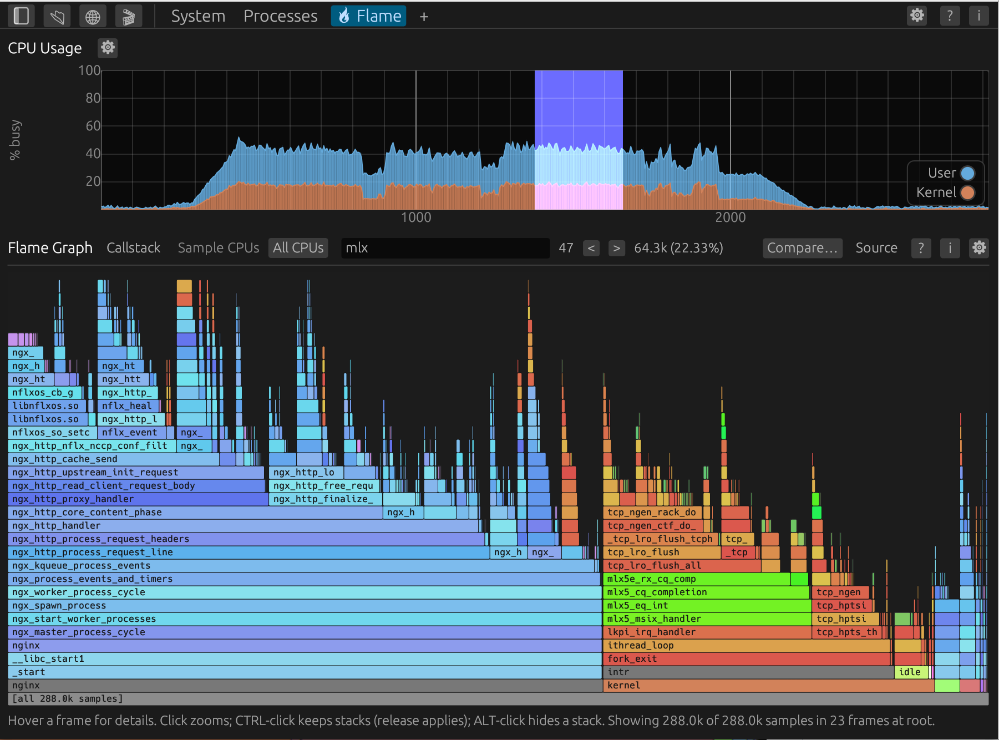
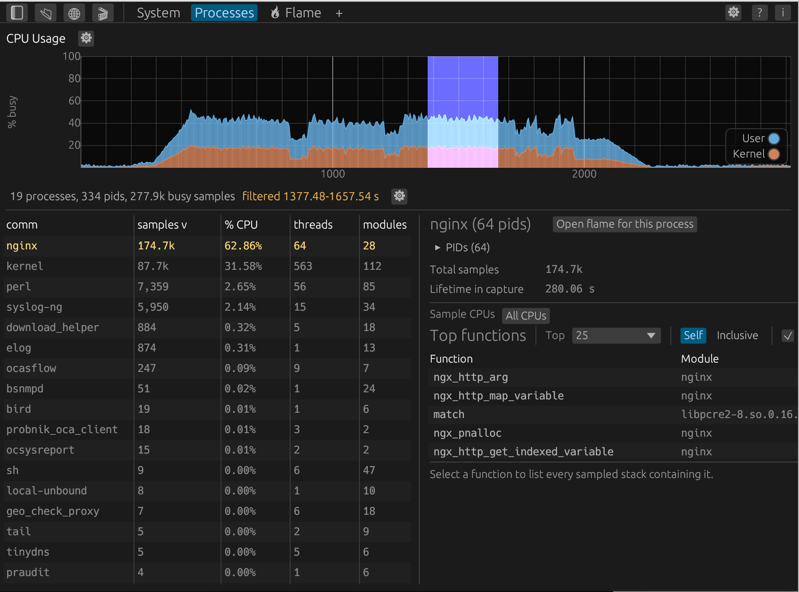
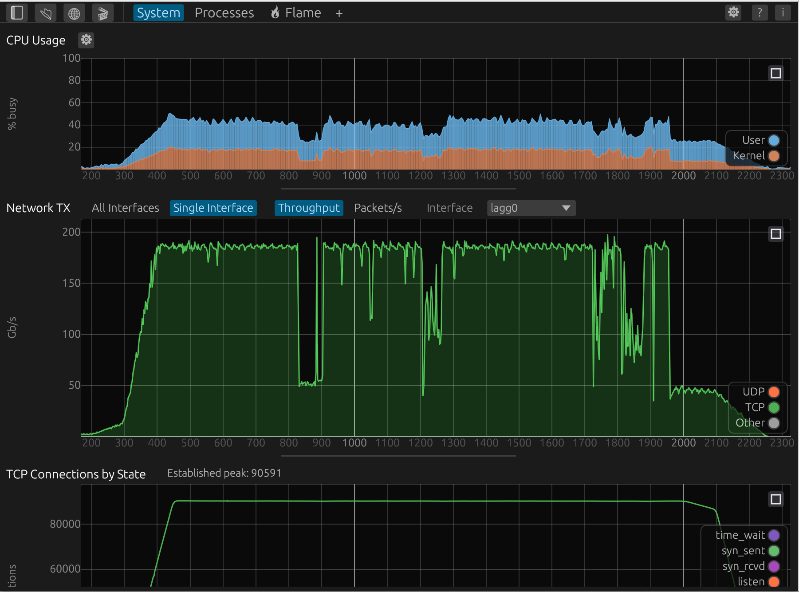

# EventExplorer

**A desktop + CLI toolkit for analyzing FreeBSD EventLog (`.elog`) captures.**

The FreeBSD [EventLog](https://man.freebsd.org/cgi/man.cgi?query=eventlog)
framework writes binary logs of events, and any subsystem — in the kernel
or in user space — can register as a *provider* and emit its own event
schema into the same file. EventExplorer opens those captures (`.elog` and
`.elog.gz`) and turns them into an interactive CPU profile, machine-wide
telemetry, and per-TCP-session timelines — all sharing one zoomable time
axis.

Today it decodes kernel providers (`tcp`, `if`, `cpu`, `hpts`) and
user-space providers (`nginx`). The parser, GUI, and CLI are
provider-agnostic and built to grow as more subsystems adopt EventLog.

Rust + egui, memory-mapped I/O, no server: it runs on your laptop against
multi-gigabyte captures on Linux, FreeBSD, and macOS (Apple Silicon or
Intel). The same GUI also compiles to WebAssembly.

## Showcase

**🔥 Flame tab** — an interactive flame graph built from `cpu` provider stack
samples, with kernel and user-mode symbolization. The CPU strip above it
(here in its Kernel vs User mode) scopes the graph, and that time window
stays in sync with the System and per-session tabs, so zooming into a bad
second anywhere carries over to the profile.



**Processes tab** — a sortable per-process CPU rollup (samples, % CPU,
threads, modules). Its CPU usage strip is the same one as Flame and
System: drag a range to limit the list, and that window stays in sync
when you switch tabs. The right side always shows the selected process,
including an "Open flame" shortcut that zooms the Flame tab to that bar.



**System tab** — machine-wide CPU, network, and TCP connection state on
the same zoomable time axis as the Flame and per-session views. CPU % busy,
Network TX (here in single-interface throughput mode: `lagg0` peaking near
200 Gb/s), and TCP Connections by State peaking past 90,000 established.



More screenshots — per-session panels, STARS/HPTS, and the CLI's
output — are in the [GUI guide](docs/gui.md) and
[CLI reference](docs/cli.md).

## Quick start

Grab a prebuilt tarball for Linux x86_64 or FreeBSD amd64 from the
[latest release](https://github.netflix.net/corp/eventexplorer/releases/latest):

```bash
tar xzf eventexplorer-*-linux-x86_64.tar.gz
cd eventexplorer-*-linux-x86_64

./event_explorer path/to/capture.elog.gz   # GUI
./elog_cli       path/to/capture.elog.gz   # CLI (defaults to session summary)
```

## Building from source

Needs [Rust](https://rust-lang.org) (edition 2021) and, for the GUI, a
graphical environment:

```bash
cargo build --release
cargo run --release --bin event_explorer -- path/to/capture.elog.gz
cargo run --release --bin elog_cli       -- path/to/capture.elog.gz summary
```

On macOS, install Apple's command line tools with `xcode-select --install`
and Rust with [rustup](https://rustup.rs), then use the same commands above.
XQuartz is not required. Builds use the current Mac's architecture; both
`aarch64-apple-darwin` and `x86_64-apple-darwin` are supported.

To create a Finder-launchable app after building:

```bash
./scripts/package-macos.sh     # target/release/EventExplorer.app
open target/release/EventExplorer.app
```

The app can be copied to Applications. Open captures with **Open File…**
or drag them onto the app window. The standalone `elog_cli` remains in
`target/release/`. macOS preferences live in
`~/Library/Application Support/event_explorer/`; flame stack selection uses
**Command-click** (Control-click on Linux/FreeBSD).

`./release.sh --native-only` packages the native binaries and, on macOS,
the app bundle into `eventexplorer-<version>-darwin-<arch>.tar.gz` without
requiring the optional web tools. The app is ad-hoc signed for local use;
distributed downloads are not Apple-notarized and may need approval in
**System Settings → Privacy & Security** on first launch.

Before committing, run what CI runs:

```bash
cargo fmt --all
cargo clippy --all-targets --locked -- -D warnings
cargo test --locked
```

### Browser build (optional)

The same GUI compiles to WebAssembly and runs entirely in a browser tab —
the user uploads the `.elog` via the page, and parsing and rendering happen
client-side:

```bash
rustup target add wasm32-unknown-unknown
cargo install --locked trunk
trunk serve                 # http://127.0.0.1:8080/
trunk build                 # static bundle in ./dist/
```

See [architecture.md](docs/architecture.md#web-target-wasm32) for what the
web build gates out and how to deploy `dist/` to a static host.

## Documentation

- [GUI user guide](docs/gui.md) — every tab and panel, overlays, and
  interaction shortcuts.
- [CLI reference](docs/cli.md) — subcommand index, arguments, and sample
  output.
- [.elog file format](docs/file-format.md) — on-disk layout and event-id
  catalog.
- [Architecture overview](docs/architecture.md) — module map, data flow, and
  recipes for adding providers, events, and views.
- [Contributing](CONTRIBUTING.md) — workflow and the AI tool usage policy.
- [Release process](docs/releasing.md) — how to cut a release.
- [AGENTS.md](AGENTS.md) — conventions for AI coding agents working in this
  repo.

## License

[Apache-2.0](LICENSE).
