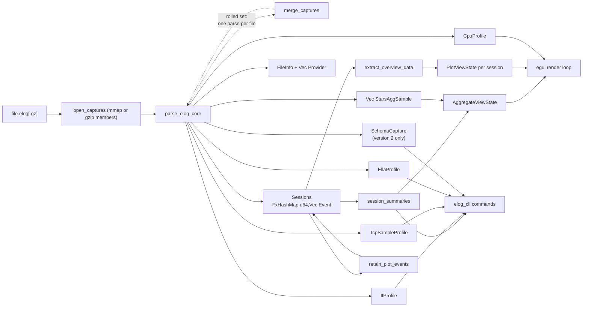

# EventExplorer Architecture

This document is written for two audiences at once:

- **Human contributors** who want to orient themselves in the codebase
  before making a change.
- **AI coding agents** who need fast, accurate context on where things live
  and what conventions are in play.

If you're here for end-user docs, see [`gui.md`](gui.md),
[`cli.md`](cli.md), and [`file-format.md`](file-format.md) instead.

## Scope

EventExplorer is a FreeBSD EventLog analyzer. The envelope (file header,
provider table, event-record framing) is generic; each *provider* inside a
capture defines its own event-id namespace and payload layouts. Today the
codebase has six provider-specific code paths:

- **`tcp`** — full event decoding, per-session grouping, and every GUI /
  CLI analysis described in [`gui.md`](gui.md) and [`cli.md`](cli.md). Also
  carries periodic `*_SAMPLE` events (ids 900–903) that ride special
  aggregate / per-stack "global" sessions (keyed by `(provider_id,
  session_id)`, since one `tcp` provider is registered per loaded stack) and
  feed a `TcpSampleProfile`. The per-stack series (requests/sec, goodput
  distribution) render as panels on the **System** GUI tab
  (`EventExplorerApp::tcp_samples_section`); the subsystem-wide PCB-state
  gauges (`TCP_SAMPLE`, id 900) also render there
  (`AggregateViewState::with_tcp_state`) and are shown by default. Both
  are dumpable via `elog_cli tcpsamples`.
- **`hpts`** — only the `STARS_AGG_SAMPLE` event, consumed as a global
  (non-per-session) time series for the aggregate view
  (`EventExplorerApp::stars_agg_section`): the STARS adaptive
  egress-rate-squeeze controller's pressure / slot-gate deny rate and
  budget / peak-burst panels.
- **`cpu`** — per-CPU kernel-thread stack samples (`CPU_SAMPLE`) plus
  thread metadata (`THREAD_CREATE`) and one-shot kernel info
  (`KERNEL_INFO`). Collected into a global `CpuProfile` and rendered
  as an interactive flame graph (`Tab::CpuFlame`); also dumpable in
  Brendan Gregg's folded-stack format via `elog_cli flame`.
- **`if`** — interface lifecycle / link / config / address changes plus
  periodic per-interface counter samples (`IF_SAMPLE_BYTES` +
  `IF_SAMPLE_PACKETS`, merged per tick in `core.rs`; the deprecated
  `IF_SAMPLE` is still decoded for older captures). Collected into a
  global `IfProfile`, rendered as **Network TX/RX** on the
  **System** GUI tab (`EventExplorerApp::interfaces_section`: All
  Interfaces totals and Single Interface TCP/UDP/Other stacks, opening
  on Single Interface; Network TX can draw `oqdrops` per second on a
  drops/s scale beside the throughput axis, toggled by Show Network
  Errors) and dumpable via
  `elog_cli interfaces` / `ifsamples` / `ifevents`.
- **`fanout_node`** — ELLA fanout node-layer user-space provider
  (older captures register as `ella_relay`). Collected into a sibling
  `EllaProfile` (not the TCP `Sessions` map: envelope `session_id` is a
  private per-channel correlator and collides with TCP ids; session 0 is
  process-global). `CHANNEL_COUNT` (id 150, `STATS_DETAILED`, removed by
  ELLA PR #481) is per-instance occupancy; `CHANNEL_COUNT_TOTAL` (id 151,
  `STATS`) is the process-wide up/dn occupancy (leave/retire per side);
  `CHANNEL_SAMPLE` (id 152, `STATS_CHANNEL`) is per-channel occupancy and
  object rates. A capture may
  list two `fanout_node` providers (ella_server + mrelay); role comes
  from `NODE_INFO` (id 2, ORIGIN → Server, RELAY → Relay) when the
  producer emits it, otherwise from the shape of that provider's
  `INSTANCE_ATTACH` set (i0 UPSTREAM or any DOWNSTREAM worker above i0
  → Relay; i0 DOWNSTREAM alone → Server). The fallback matters because
  attaches all land in the first microseconds of process start, where a
  capture that joins late drops them (`user_dropped (prejoin)`).
  System-tab plots are grouped by that node, one plot-catalog row per
  (role, plot) pair — **Fanout Server TX** is shown by default (RX,
  Frame Send/Duration/Ratio, Errors hidden; the Server has no
  Subscribers or Channels rows), and **Fanout Relay Subscribers** /
  **RX** are shown by default (TX, Frame Send/Duration/Ratio, Channels,
  Errors hidden).
  Internal / External stay
  faces *within* a node. Plots prefer `CHANNEL_COUNT` when present
  (`build_ella_relay_plot` / `build_ella_relay_plot_for`: per-instance
  subscriber lines when there are ≤4 Fanout instances *on that node*,
  otherwise internal vs external; Channels is an Upstream plot then a
  Downstream plot with a Max/Sum toggle). A STATS-only capture plots
  `CHANNEL_COUNT_TOTAL` instead (Max/Sum hidden).
  Fanout RX and Fanout TX are stacked object Mbps per title
  (`build_ella_object_rate_stacks`: same STARTED→COMPLETED `bytes`
  boxes as the channel-tab Object Rate plots, GOP-boundary hold;
  intervals longer than a GOP are dropped).
  **Frame Send** (System) and the channel **Server Frame Rate** /
  **Relay Frame Rate** plots are byte-weighted Mbps from `FRAME_SENT` /
  `FRAME_RELAY` when present, else `FRAME_SAMPLE` (`frame_len * 8 /
  duration_us`): origin planned vs actual send, relay wire / recv /
  fwd. System sums titles into one line per metric; the channel tab
  splits origin vs relay onto two plots (one plot when the capture has
  a single node). Per-frame origin bursts are summed into 100 ms bins
  so the staircase is GOP-square rather than a scribble at each
  completion. Actual (origin) and Wire (relay) start visible;
  Planned / Recv / Fwd stay in the legend but start hidden. System
  duration-ratio plots (actual/planned, recv/wire) keep Max in the
  legend but start it hidden, and their y-axis follows the visible
  series instead of pinning 0. The channel tab's **Duration Ratio** /
  **Relay Duration Ratio** plots are the per-channel version
  (`frame_ratio_channel_series`): the same Median/P75/P95/Max bins
  scoped to the title, RX/TX-prefixed per side, with the
  same prefer-detailed-events / `FRAME_SAMPLE`-fallback rule, Max
  hidden, and an unpinned y-axis (shared by the channel frame-rate
  plots). Channel-tab line plots (Subscribers, rates, durations,
  ratios, Errors) are time-weighted into the Time buckets count
  (default 250) over the visible
  window, same count as System HTTP RPS. A long occupancy hold
  covers every overlapping bin. Origin
  `FRAME_SENT` is per-frame at frame-end on current Ella (older
  captures still burst at GOP-end, so ~2s gaps are the cadence, not a
  stall). **Frame Duration** (System Internal/External on relay; channel
  **Server Frame Duration** / **Relay Frame Duration**) is mean
  per-frame milliseconds from the same events (`sum_us / frames`):
  origin Planned/Actual, relay Wire/Recv/Fwd, y unpinned. All duration
  series start visible so intercept (Recv/Fwd holding above Wire) is
  readable next to the ratio spike. A skipped fetch paints the next **Object Timeline** block red
  and shows a long GOP on **Object Duration**.
  The three per-title stacks are built per provider and drawn in that
  node's own block, so a color-key click carries a bare title that
  resolves to that title's tab. Fanout Subscribers carries the
  Aggregate / Per channel selector (`EllaSubsView`, default Per
  channel) on any node that has sampled Internal / External totals as
  well as a per-title stack; the setting is one field, shared by every
  node's plot. Per-title stacks share one peak-external-occupancy
  ranking (`build_ella_node_title_stacks`) so Subscribers / RX / TX
  colour keys, stacked bands, and cursor tooltips agree; colours follow
  that order (`ella_title_colors`), with each node's bands offset into
  their own palette range.
  Lifecycle, subscriber, and object events are per-channel
  (`SESSION_CREATE` at first JOIN) and open as `Tab::EllaChannel` tabs
  from the session list or a Per-channel color-key click
  (`build_ella_channel_plot`, `build_ella_channel_events`,
  `build_ella_channel_list`, `ella_channel_for_stack_label`). Occupancy
  is `CHANNEL_SAMPLE` when the title has samples (same gauge as System
  Per channel and Peak); otherwise unique `SUBSCRIBED`/`UNSUBSCRIBED`
  per instance+address. Internal and External share one Subscribers
  plot when the title spans many Fanout instances; `OBJECT_STATE` drives an Object-rate plot
  (`bytes` spread over STARTED→COMPLETED as Mbps, dropping intervals
  longer than a GOP so a missing roll is a hole rather than one
  stretched object; upstream RX, downstream TX), and `CHANNEL_ERROR`
  drives cumulative per-code
  error lines.   A tab covers a whole title:
  `ella_channel_tab_members` collects every envelope session of that
  name (every reincarnation on every node). `build_ella_channel_plot_for`
  / `build_ella_channel_events_for` group events and samples by session
  in one pass, then draw those members together, naming series
  `<node> - <side>` past one member. A side with a lone instance on a
  node reads as just its side; `i<N>` comes back once it runs more.
  Object Rate is Server / Internal / External Mbps (`OBJECT_STATE`
  bytes over STARTED→COMPLETED; External is the Timeline's selected
  worker). With no `OBJECT_STATE`, that plot uses `CHANNEL_SAMPLE`
  `object_bytes` over each stats tick.
  **Object Timeline** is three lanes (Server, Relay Internal, Relay
  External; Server on top). Color flips each GOP. External has a
  **Median / P75 / P95 / Max** selector (default Median) that chooses
  one worker whose GOP-duration score sits at that percentile; Internal
  is the ingest instance.
  Red means the previous object id was skipped. A bar is STARTED until
  the next object's first packet.
  **Frame Timeline** (`FRAME_SENT` / `FRAME_RELAY`) uses the same lanes
  and GOP colors: origin Actual laid from object STARTED, Internal/External Recv.
  Adjacent frames alternate light/dark of that GOP color.
  **Object Duration** is STARTED until the next object's first packet:
  Server and Internal are that face's copies; External is Median / P75 /
  P95 / Max across workers of that GOP (P75+ start hidden).
  Trailing teardown drops are omitted so the y-axis
  stays on typical GOPs.
  **Object Size** is that GOP's payload in **MB** (same split).
  The Session List folds a title's
  nodes into one row too (`ella_nodes_label` gives the `Server + Relay`
  cell); its Rate column is the time-weighted mode of each member's
  upstream RX on Relay and downstream TX on Server, pooled.
  Stretch and Frame come from `FRAME_SAMPLE` on that same side
  (`frames_stretched / frames`, and byte-weighted
  `sum_frame_len / sum_actual_us`).
  Per-title occupancy
  (`build_ella_subscription_stack`) counts downstream
  `CHANNEL_SUBSCRIBER` `SUBSCRIBED` by short name until
  `UNSUBSCRIBED` or that instance's `CHANNEL_DESTROYED`. Which wire
  value is `UNSUBSCRIBED` comes from the blob's `subscriber_state` enum
  table (`PayloadReader::enum_name`), normalized on ingest onto the
  `ELLA_SUBSCRIBER_*` constants, since ELLA PR #460 renumbered it.
  Dumpable via
  `elog_cli ella` / `ellastats` / `ellaevents`. Schema lives in ELLA PR
  #456 (`otto/fanout-channel-eventlog`); `OBJECT_STATE` is id 200.

- **`mem`** — kernel system-memory time series (`MEM_INFO`,
  `SYS_SAMPLE`), decoded by schema field name in `elog_parser/mem.rs`
  into `SchemaCapture::mem`, turned into GiB step series by
  `analysis/memory.rs`, and drawn as the System-tab **Memory** stack
  (bottom to top: Wired, Active, Inactive, Laundry, Other, Free;
  the title **?** explains each band), **Memory Pressure** lines,
  and a **Swap** line (`app/memory.rs`). All three start hidden.
  Dumpable via `elog_cli mem`.

A capture may list the same provider name (e.g. `tcp`) on more than one
provider id, so the parser routes events through a `provider_id →
ProviderKind` map rather than a single remembered id.

Every other piece — file loading, mmap/gzip handling, the parser driver,
`FileInfo` / `Provider` types, summary and plot data structures, the GUI
window/tab framework, the CLI dispatch table — is provider-agnostic. When
another kernel subsystem adopts EventLog, extending EventExplorer to
support it is local: add its event-id catalog, a payload decoder, and
(if it deserves its own UI) a new view. Everything else stays where it is.
See [Add support for a new provider](#add-support-for-a-new-provider) for
the full recipe.

## Module map

The crate ships two binaries (`event_explorer`, `elog_cli`) and a
WebAssembly cdylib from a single library of modules. Everything lives
in [`src/`](../src/). The three formerly-monolithic source files
(`app.rs`, `elog_parser.rs`, `cli.rs`) are now module *directories*; the
top-level `.rs` of the same name (where one still exists) is either the
module root or a thin binary shim.

| Path | Role |
|------|------|
| [`src/lib.rs`](../src/lib.rs) | Library root. Declares the `analysis`, `app`, `elog_parser`, and (native-only) `cli` modules so both desktop bins consume them via `use event_explorer::…`. On `wasm32-unknown-unknown` it also defines `WebHandle`, the `wasm-bindgen`-exported entry point that boots the same `EventExplorerApp` inside a browser canvas. |
| [`src/main.rs`](../src/main.rs) | `event_explorer` (desktop GUI) entrypoint. Sets up the eframe/winit viewport, loads the embedded icon, queries the primary monitor, restores window state, and hands every CLI-supplied path (if any) to the app, so a shell glob over a rolled set opens as one capture. Excluded from the wasm build via `required-features = ["native-bins"]`. |
| [`src/elog_parser/`](../src/elog_parser) | The parser and all shared on-disk data types. Used by both binaries and the wasm build. Submodules: `constants.rs` (`EVT_*`, flag, and size constants, plus the version-2 `PROVIDER_SIZE_V2` / `SCHEMA_ID_LEN` / `EVENTLOG_DECODE_*` / `DECODE_*` constants), `names.rs` (`event_name`, `if_event_name`, `pacing_cap_name`, `format_*_flags`, `hpts_wheel_event_name`, `hpts_bind_type_name`, `ella_relay_event_name`), `types.rs` (`Sessions`, `Event`, `EventPayload`, `FileInfo`, `Provider` (incl. `schema_*` fields), `StarsAggSample`, `CpuProfile`, `IfProfile`, `TcpSampleProfile`, `EllaProfile`, `SymbolHit`, `SchemaCapture`, `GenericEvent`, `HptsWheelEvent`/`HptsWheelPayload`, …), `bytes.rs` (little-endian readers + `format_if_addr`), `payload.rs` (`parse_payload`), `schema.rs` (`ProviderSchema` — the version-2 `EDB1` decode-blob reader/formatter, ported from the FreeBSD `decode.c`; `compute_schema_id`), `schema_validate.rs` (`ExpectedField`/`ExpectedEvent`, the `TCP_EXPECTED`/`IF_EXPECTED`/`CPU_EXPECTED`/`HPTS_EXPECTED`/`ELLA_EXPECTED`/`ELLA_RELAY_EXPECTED` tables, `validate_hardcoded_decoders`, and the `*_has_hardcoded_decoder` predicates), `hpts_wheel.rs` (`parse_hpts_wheel_payload` — the `hpts` provider's timing-wheel scheduler-trace decoder, ids 0-12), `ella.rs` (`ingest_ella_server` / `ingest_ella_relay`), `core.rs` (`ProviderKind`, `parse_elog_core`), `merge.rs` (`merge_captures` — folds per-file parse results into one continuous capture for a rolled set), `io.rs` (`open_file`, `fetch_remote`, `parse_elog`, `parse_elog_with_progress`, `parse_elogs`, `parse_elogs_with_progress`, `parse_elog_bytes_with_progress`; path/SSH loaders are desktop-only, the in-memory byte loader works on both targets), `progress.rs` (`LoadProgress`). The module root (`src/elog_parser.rs`) holds the parser unit tests. |
| [`src/analysis/`](../src/analysis) | Higher-level analytics layered on top of the parser types (the parser never depends on this module). Submodules: `session.rs` (`SessionSummary`, `ConnParams`, `SessionAuxData`, `session_summaries`, `retain_plot_events`), `rate.rs` (`OverviewPlotData`, `extract_overview_data`, `compute_send_rate` / `compute_ack_rate` / `compute_ack_delivery_rate`), `limiter.rs` (`Limiter`, `LimiterSpan`, `LimiterSummary`, `build_limiter_spans`, `classify_bucket`), `goodput.rs` (`compute_kernel_goodput`, …), `cpu.rs` (per-process / CPU usage bins), `flame.rs` (`FlameNode`, `FlameFilter`, `FlameAggregation`, `build_flame_tree`, `fold_flame_tree`, `FlameDiff`, `build_flame_diff`), `functions.rs` (ASLR-independent per-binary rankings, stack drill-downs, and source-PC histograms), `samples.rs` (derives plottable time series from periodic provider profiles). Consumed by both the GUI and CLI. |
| [`src/app/`](../src/app) | The egui GUI. `state.rs` holds the `EventExplorerApp` struct's main inherent `impl`; `update.rs` is the `eframe::App` impl; per-view files include `aggregate.rs`, `processes.rs`, `flame.rs`, `functions.rs`, `source.rs`, `cpustrip.rs`, `samples.rs`, and the provider-specific views. `functions.rs` renders process-scoped per-binary rankings and stack drill-downs in the Processes detail panel. Native `source.rs` prompts for a local ELF/debug file, validates its build id, resolves sample offsets through DWARF off the UI thread, applies source-prefix rewrites scoped by executable image (including the nginx ports expanded-source layout), persists accepted lookup choices as user-confirmed defaults for later captures, and renders virtualized annotated-source tabs; wasm retains an unavailable state. Leaf helpers live in `colors.rs`, `file_dialog.rs` (native in-app filesystem browser), `format.rs`, `plot.rs`, `plot_layout.rs`, and `sidebar.rs`. The module root (`src/app.rs`) holds `EventExplorerApp`, `Tab`, and `View`. Expensive CPU-profile analysis shares the `Arc<CpuProfile>` with worker threads. Filesystem and process features are gated `#[cfg(not(target_arch = "wasm32"))]`. |
| [`src/cli.rs`](../src/cli.rs) | Thin `fn main` shim for the `elog_cli` binary; calls `event_explorer::cli::run()`. |
| [`src/cli/`](../src/cli) | `elog_cli` command logic, exposed as the library module `cli` (native-only, gated by `native-bins`). `mod.rs` holds `run` (argv dispatch), `print_usage`, and `parse_session_id`; `cmd_*` handlers are grouped into `summary.rs`, `rtt.rs` (incl. `pearson_r`/`percentile`/`compute_pairwise`/`analyze_session`), `goodput.rs` (incl. the `gpsim` state machine), `events.rs`, `interfaces.rs`, `flame.rs`, `stars.rs`, `percore.rs`, `hpts.rs` (`cmd_hpts_events`/`cmd_hpts_lateness`/`cmd_hpts_gaps` — the `hpts` timing-wheel-trace subcommands, version 2 captures only), `ella.rs` (`cmd_ella` / `cmd_ella_stats` / `cmd_ella_events`). |

Crate configuration lives in [`Cargo.toml`](../Cargo.toml). The wasm
build is bundled by [`Trunk.toml`](../Trunk.toml) /
[`index.html`](../index.html). Release tarball assembly (desktop only)
is in [`release.sh`](../release.sh).

## Data flow



Two concrete paths through the same parser:

- **GUI path** — `parse_elog_with_progress` runs on a background thread and
  streams permille progress through an `AtomicU32`. When it finishes, the
  main thread receives the parsed data over an `mpsc` channel, computes
  `session_summaries`, calls `retain_plot_events` to drop non-plot variants,
  builds an `AggregateViewState`, and (for each opened session)
  `extract_overview_data` into a `PlotViewState`.
- **CLI path** — `parse_elogs` runs synchronously on the main thread; each
  subcommand consumes the parsed data immediately. Some commands (notably
  `memtest`) take ownership of the session map so they can run
  `retain_plot_events` as part of their measurement.

Both loaders go through `parse_elogs`/`parse_elogs_with_progress`, which
parse each given file independently and hand the results to
`merge_captures` (`merge.rs`). A `.gz` whose members are separate
compressed captures takes the same path inside `parse_elog_with_progress`.
Everything downstream sees a single
`ParsedCapture`, so a rolled set costs the analysis and view layers
nothing — the earliest file's `capture_start` becomes the shared origin,
per-session event lists are concatenated by `session_id`, the global
sample streams are appended in time order, and the identity maps
(threads, linker files, interfaces, TCP stacks, Fanout channels) upsert
exactly as they do for the dump-state replay `elog` re-triggers at each
roll boundary within one file. See
[cli.md → Rolled capture sets](cli.md#rolled-capture-sets) for the two
invariants the merge validates.

Every `merge_*` helper destructures its input struct field by field with
no `..` rest pattern, so adding a field to `FileInfo`, `CpuProfile`,
`IfProfile`, `TcpSampleProfile`, `EllaProfile`, `SchemaCapture`, or
`Provider` fails to compile until the merge is taught what to do with
it. Keep it that way — a silent default would drop that field's data for
every multi-file load.

## Key types cheat-sheet

Parser types live in [`src/elog_parser/`](../src/elog_parser) (mostly
`types.rs`); analysis types (`SessionSummary`, `OverviewPlotData`,
`PacingCapSpan`, `ConnParams`, `Limiter*`, `Flame*`) live in
[`src/analysis/`](../src/analysis).

| Type | One-liner |
|------|-----------|
| `Sessions` | `FxHashMap<u64, Vec<Event>>`. Primary post-parse data structure. |
| `Event` | `{ ts, cpu, tid, event_id, payload }`. Per-event record. |
| `EventPayload` | Enum with one variant per decoded event family: `Rtt`, `Ack`, `Out`, `Goodput`, `Cwnd`, `GpCheck`, `PacingCalc`, `RttUnderflow`, `ConnSetIpV4`, `ConnSetIpV6`, `ConnParamsV2`, `LogId`, `EnterRecovery`, `ExitRecovery`, `PaceState`, `UserSend`, `SendFile`, `SessionCreate`, `Other`. |
| `FileInfo` | Parse counters (version, timestamps, parsed/skipped/dropped). |
| `Provider` | `{ id: u16, name: String }`. One row of the provider table. |
| `StarsAggSample` | Global HPTS `STARS_AGG_SAMPLE` snapshot (not tied to a session): the STARS adaptive egress-rate-squeeze controller's pressure gauge, slot-gate admit/deny counters, meter/token state, and config (`slot_gate_enable`, `health_limit_bps`, `min_rate_bps`). |
| `IfProfile` | All `if`-provider data: `interfaces: FxHashMap<u16, IfInterface>` (metadata keyed by ifindex), `samples: Vec<IfSample>` (cumulative per-interface counters, sorted by ts), `events: Vec<IfEvent>` (lifecycle/link/config timeline, sorted by ts), `period_us`, `nifs`. Consumed by the `elog_cli interfaces` / `ifsamples` / `ifevents` commands, which diff successive `samples` per ifindex to derive TX/RX rates. |
| `TcpSampleProfile` | All `tcp`-provider periodic-sample data: `stacks: FxHashMap<(u16, u64), TcpStackInfo>` (per-stack identity + period from `TCP_STACK_INFO`, keyed by `(provider_id, session_id)` — every `tcp` provider numbers its stack-global session identically, so `session_id` alone collides across loaded stacks), `state_samples: Vec<TcpStateSample>` (subsystem-wide PCB-state gauges, on the aggregate session), `rps_samples: Vec<TcpRpsSample>` (cumulative request counts), `gp_samples: Vec<TcpGpSample>` (cumulative goodput histograms) — each sample carries `provider_id`, all sorted by ts. `stack_label(provider_id, session_id)` resolves the display name (or `tcp#<provider>` when a stack emitted no `TCP_STACK_INFO`). Consumed by `elog_cli tcpsamples`. |
| `EllaProfile` | All `fanout_node` / `ella_relay` channel-layer data: `channels: FxHashMap<(u16, u64), EllaChannelInfo>` (identity keyed by provider + envelope session_id; session 0 is omitted), `events: Vec<EllaEvent>` (lifecycle / subscriber / object / error payloads), `counts: Vec<EllaChannelCount>` (per-instance `CHANNEL_COUNT` on the global session), `counts_total: Vec<EllaChannelCountTotal>` (process-wide `CHANNEL_COUNT_TOTAL`), `instances: FxHashMap<(u16, u32), u8>` (`INSTANCE_ATTACH` side, keyed `(provider_id, instance_id)`), `roles: FxHashMap<u16, u8>` (`NODE_INFO` role per provider). `node_role(provider_id)` reads `roles` when present and otherwise infers Server vs Relay from the attach set. `is_empty()` / `has_channel_counts()` gate the System-tab panels and the channel list. Consumed by `elog_cli ella` / `ellastats` / `ellaevents`. |
| `CpuProfile` | All cpu-provider data from a capture: `samples: Vec<CpuStackSample>` (sorted by ts), `threads: FxHashMap<u32, ThreadInfo>`, `kernel: Option<KernelInfo>`, `linker_files: FxHashMap<u32, LinkerFile>`, `symbols: FxHashMap<u32, Vec<SymbolRange>>` (sorted by offset per file), `user_files: FxHashMap<u32, UserFile>`, `proc_maps: FxHashMap<u32, Vec<ProcMap>>` (per-pid, sorted by base), `user_symbols: FxHashMap<u32, Vec<UserSymbolRange>>` (per-`user_file_id`, sorted by offset), `overflow_dropped: u64`. `is_empty()` gates the flame-graph tab. `symbolize(pc, pid: Option<u32>) -> Option<SymbolHit>` tries the kernel resolver (`symbolize_kernel`) first and the per-pid user resolver (`symbolize_user`) second; `format_pc(pc, pid, with_file)` adds the cascade through `kernel+0xOFFSET` and raw hex. The same `CpuProfile` powers both the GUI and `elog_cli flame`. |
| `CpuStackSample` | One per `EVT_CPU_SAMPLE`: `ts, cpu, tid, pid, sample_type, flags, frames: Vec<u64>` (leaf-first, ≤`STACK_MAX`=18 in practice). The `pid` is what the user-mode resolver keys on. |
| `LinkerFile` / `SymbolRange` | Kernel symbolisation metadata captured from `EVT_CPU_LINKER_FILE` (per loaded `.ko` / kernel image) and `EVT_CPU_SYMBOL_RANGE` (synthesised by `elog --embed-symbols`). `LinkerFile.is_kernel()` gates the v1-only kernel-image symbol path. After parse, the per-file `Vec<SymbolRange>` is sorted by offset and any `size == 0` entry is extended to span up to the next entry's offset (capped by `LinkerFile::size` for the last entry), mirroring pmcstat(8). This makes hand-written kernel asm entry points (`Xtimerint`, `fork_trampoline`, `Xfast_syscall`, `calltrap`, …) — whose ELF `st_size` is 0 because the asm macros never emit `.size` directives — resolvable by `CpuProfile::symbolize`'s binary search instead of falling back to `kernel+0xOFFSET`. |
| `UserFile` / `ProcMap` / `UserSymbolRange` | User-space counterparts of `LinkerFile` / `SymbolRange`, captured from `EVT_CPU_USER_FILE` (event id 7), `EVT_CPU_PROC_MAP` (8), and `EVT_CPU_USER_SYMBOL_RANGE` (9). All synthesised by `elog -U` (the `cpu` provider's `USER_META` keyword) — the kernel never emits these. `UserFile` is content-addressed by `user_file_id` and shared across every `ProcMap` that references the same backing ELF; `ProcMap` carries the per-pid `(base, size, offset)` needed to translate runtime VA to a file offset via `pc - pm.base + pm.offset`; `UserSymbolRange` is stored in file-offset coordinates so processes that share a DSO share the symbol table. The same zero-sized-entry fill-in pass used for kernel `SymbolRange` is applied to `user_symbols` (handles pthread stubs, hand-written `memcpy` variants, ifunc resolvers). `UserFile::short_name()` returns `basename(pathname)` for tooltip / `--show-module` use. **v1 limitations:** `elog -U` snapshots a pid's `vm_map` lazily on first sight (post-`dlopen` libraries miss until a future revision re-snapshots); only the leaf user PC is captured (no user-side stack unwinding — would need pmcstat-style AST hooks). |
| `SymbolHit<'a>` | Enum returned by `CpuProfile::symbolize(pc, pid)`. Three variants: `Kernel { file: &LinkerFile, symbol: &SymbolRange, inner_offset: u64 }`, `User { file: &UserFile, map: &ProcMap, symbol: &UserSymbolRange, inner_offset: u64 }`, and `UserModuleOnly { file: &UserFile, map: &ProcMap, runtime_offset: u64 }` (the DSO-only fallback used when a PC is in a known `PROC_MAP` but no `USER_SYMBOL_RANGE` covers the resulting file offset). Variant-agnostic accessors `name()` (DSO basename for `UserModuleOnly`), `inner_offset()` (runtime mapping offset for `UserModuleOnly`), `has_symbol()` (false for `UserModuleOnly`), `file_short()`, `label()` (`name+0xINNER` or `libfoo.so+0xRUNTIME_OFFSET`), and `label_with_file()` (`file:name+0xINNER` or just `libfoo.so+0xRUNTIME_OFFSET` for module-only — no double-prefix) let the renderer format any frame uniformly without caring whether it landed in kernel or user space. |
| `FlameNode` / `FlameFilter` / `FlameAggregation` | Flame-graph aggregation primitives. `build_flame_tree(profile, filter, aggregation, split_user_by_pid, group_by_process) -> FlameNode` walks samples leaf→root, RLE-aggregating shared prefixes by `(addr, pid)`. When `group_by_process` is set, a synthetic first frame (`FlameNode.group_label`: process `comm`, or `"kernel"` for kernel threads) sits under the root so the flame reads as one tower per process. Kernel samples share that one `kernel` bar; thread `comm` (`idle`, `intr`, `clock`) sits on it. GUI default on, CLI default off. `build_flame_tree_with_base(..., kernel_user_base, kernel_group)` is the gear layout dropdown: **kernel / user** inserts `kernel` and `user` under that root first (the canvas hides `[all]`); **no kernel group** keeps user-process bars and hangs kernel stacks on the root. Aggregation modes: `ByPc` (one node per unique PC + pid; user PCs always stay pid-scoped because raw PCs are ASLR-dependent), `BySymbol { with_offset_overlay }` (collapse PCs to their resolved symbol; for kernel hits the key is `LinkerFile::base + SymbolRange::offset` with pid 0, for user hits the builder canonicalises on the stable `(UserFile::user_file_id, UserSymbolRange::offset)` identity — the canonical `(addr, pid)` is the first pid we ever saw for that symbol, so N forks of the same binary fold into one tower and the renderer's pid-scoped re-symbolisation still resolves correctly; passing `split_user_by_pid: true` opts out and keeps the legacy per-pid scope. With the overlay flag, leaf-self samples become synthetic per-PC `is_self_pc` child nodes and their raw PC is rebuilt as `canonical_parent_addr + inner_offset` so identical inner offsets from different pids merge onto one overlay rectangle instead of shattering per-ASLR-slide). `BySymbol { with_offset_overlay: true }` is the GUI default; `BySymbol { with_offset_overlay: false }` is the CLI default; `split_user_by_pid: false` (merge across pids) is the default in both. `fold_flame_tree(root, |addr, pid| ...)` emits Brendan Gregg folded-stack format. |
| `SessionSummary` | Per-session rollup used by both the session list and the aggregate CDFs. |
| `OverviewPlotData` | Pre-computed series (RTT variants, rates, cwnd/ssthresh/inflight, peer rwnd, sndbuf, recovery spans, goodput spans, pacing caps, send/ACK sizes, limiter spans) for one session. Consumed by `PlotViewState`. |
| `PacingCapSpan` | `{ t_start, t_end, cap }`. One contiguous `PACING_CALC_V2 cap_source` region. |
| `ConnParams` | Per-session negotiated parameters from `CONN_PARAMS_V2`: `iss`, `irs`, `snd_wscale`, `rcv_wscale`, `flags` (SACK/TS/ECN/…), `cc_algo`. Gate for peer RWND series and `Rwnd`-limited classification. |
| `LimiterSpan` | `{ t_start, t_end, class: Limiter }`. One RLE time bucket from `build_limiter_spans`. |
| `LimiterSummary` | Time-weighted percentages per `Limiter` class; includes `pacing_pct`, `cwnd_pct`, `rwnd_pct`, `app_pct`, `unknown_pct`, `idle_pct`. |
| `Limiter` | Enum: `Cwnd`, `Rwnd`, `Pacing`, `App`, `Unknown` (mystery gap — backlog present but no sends), `Idle` (true idle). |

GUI-side, in [`src/app/`](../src/app):

| Type | One-liner |
|------|-----------|
| `EventExplorerApp` | Root `eframe::App` impl. Holds parsed data, UI state, tabs, window state, System `system_layout` / `system_draft`, plot-catalog sidebar. |
| `View` | `NoFile` / `Loading { progress, … }` / `Loaded`. Drives the central panel. |
| `Tab` | `Aggregate` / `SessionList` / `Session(u64)` / `EllaChannel { provider_id, session_id }` / `CpuFlame` / `Processes` / `Events`. Current foreground tab. `CpuFlame` and `Processes` are shown only when the capture has cpu-provider data. `EllaChannel` is one ELLA relay channel session. `Events` opens from the trace-info Providers **More details...** link and lists every event id with record sizes (`Provider.events`). nginx HTTP requests are rows on the TCP session they belong to. |
| `FlameViewState` | `Tab::CpuFlame` state: precomputed `FlameNode` tree, `zoom_path: Vec<(u64, u32)>` (stack of clicked-into `(addr, pid)` keys; frames under the zoomed root draw as one `a > b > c` bar (click steps down one level); pid carried alongside addr so user-mode breadcrumbs route through the per-pid resolver), `back_stack: Vec<Vec<(u64, u32)>>` (browser-style navigation history), `search` substring (`|` is OR) plus `search_match_idx` for Next/Prev zoom, `FlameFilter` (cpu/pid/tid/comm/time-range allowlists — `CPU_SAMPLE_FLAG_IDLE` / `CPU_SAMPLE_FLAG_TRUNC` are *not* filter knobs; see below), `rel_text` toggle for `kernel+0xOFFSET` fallback labels, `show_module` toggle for `file:name+0xINNER` (kernel) or `dso:name+0xINNER` (user) symbol prefixes, `split_user_by_pid` toggle (default off) for the cross-pid user-symbol merge, `organize` gear dropdown (`FlameOrganize::ByProcess` default; also `KernelUser` and `NoKernelGroup`), `aggregation: FlameAggregation` (defaults to `BySymbol { with_offset_overlay: true }`), and `compare: Option<FlameCompareState>` for the differential view (see below). Built lazily on first switch to the tab; rebuilt when the filter, aggregation, or any other shape-affecting toggle changes. The back-history is wiped on aggregation switches (zoom-path keys aren't comparable across modes). Idle samples are no longer emitted by fresh kernels (the statclock hook returns early for the idle thread) and truncated stacks are ≤ 0.003 % of samples in practice, so neither has a dedicated filter — older captures with empty-stack idle samples surface as a single `IDLE` row on the synthetic root. |
| `PlotViewState` | Everything about one open session: precomputed plot series (including raw_rwnd, raw_sndbuf), `view_x`, zoom stack, catalog `plot_layout` / `plot_draft` (heights and maximize), Y overrides, tooltip state, custom label, and info-popup open state. |
| `PlotLayout` | Per-tab catalog: `order`, `hidden`, `locked`, independent `heights` / `slot_heights`, `maximized` / `maximized_slot`. **Every `Plot` widget must get a maximize button and a bottom sizer** — see [Plot chrome (required)](#plot-chrome-required). Locking a row locks the prefix above it; that prefix pins above scroll. System, session, and Fanout channel each keep an applied copy and a sidebar draft. |
| `AggregateViewState` | Precomputed aggregate curves (session count over time, subsystem-wide TCP PCB-state gauges, establish/teardown rates from those gauges, RTT CDF, goodput CDF) with paced vs not-paced splits. Rebuilt when `filter_low_events` toggles; the PCB-state series and connection-rate series are attached by `with_tcp_state` (independent of the filter). Each panel is rendered only when it has data. |
| `WindowState` | Persisted window geometry in the platform's `dirs::config_dir()/event_explorer/window_state.txt`. |

## GUI state machine

```
    ┌───────────┐   open file    ┌──────────────┐   parse ok   ┌─────────┐
    │  NoFile   │──────────────▶│   Loading    │──────────────▶│ Loaded  │
    └───────────┘                └──────────────┘               └─────────┘
         ▲                                │                          │
         │  parse error / close file      │                          │
         └────────────────────────────────┴──────────────────────────┘
```

Inside `Loaded` the tab bar drives which sub-view renders:

- `Tab::Aggregate` → `show_aggregate_view` (CPU strip, NIC TX/RX
  including protocol stacks, TCP PCB-state, Fanout Relay Subscribers/RX
  and Server TX, plus
  catalog-hidden session CDFs, HTTP RPS, per-stack TCP histograms,
  the other Fanout rows, HTTP completion bytes, STARS, HPTS). Layout comes from
  `system_layout` / the plot-catalog sidebar.
- `Tab::SessionList` → `show_session_list` (reachable via the `+` tab;
  TCP sessions plus an ELLA channel table when present).
- `Tab::Session(id)` → `show_plot_view` against the matching
  `PlotViewState` in `open_sessions`.
- `Tab::EllaChannel { provider_id, session_id }` →
  `show_ella_channel_view` against the matching `EllaChannelViewState`
  in `open_ella_channels` (occupancy plot plus a lifecycle/joins event
  table).
- `Tab::CpuFlame` → `show_cpu_flame_view` against the lazily-built
  `FlameViewState`. Only present when the capture has cpu-provider
  data; cpu-only captures fall through `Tab::Aggregate` into this view.
  Switching to Flame or Processes copies the System tab's `view_x` into
  the shared time filter; leaving either copies it back onto System.
  Session and Fanout channel `view_x` stay per-tab.
- `Tab::Events` → `show_events_view`. Opened from the trace-info
  popup's Providers **More details...** link. Providers that share a
  name are combined. One row per event id
  (count, bytes, payload, min/max, rate) plus a provider bar. A
  selected row lists schema fields when the capture embedded a
  decode blob. The parser fills `Provider.events` during the event walk.
- `Tab::Processes` → `show_processes_view` against the lazily-built
  `ProcessesViewState`. Only present when the capture has cpu-provider
  data. Its CPU usage strip is the Flame strip (`cpu_usage_strip_flame`,
  same gear). The shared `ts_start_us` / `ts_end_us` filter the flame
  and, via a background rollup, the process rows, rankings, and stacks.
  Rows match the flame's Group-by-process bars by default (gear:
  **Split by thread name** or **Split by pid**). "Open flame" zooms
  the Flame tab to that bar (`zoom_path`). A kernel thread opens the
  merged `kernel` bar. Zoom:
  all / middle-click / mouse-back restore the full graph.

Single-session captures auto-focus the only session's tab and never show
`Aggregate`.

### CPU selection

The **Sample CPUs** selector shares `FlameFilter.cpus` with
Processes' Top functions: individual sampled IDs or comma-separated ranges
restrict rankings, stack drill-downs, source sample counts, and both sides of
a flame comparison. Empty means all CPUs. `app/cpu_filter.rs` owns the selector
and capture-local input state; the function view compares the complete filter
before accepting background results. CPU Usage follows the same selection in
every tab and both comparison captures, including zoomed bins and all four
display modes. Its percentage is relative to the selected sampled CPUs;
the process list retains its all-CPU context. The selection resets on a new
primary capture.

### Differential flame (Compare…)

The Flame tab's **Compare…** button parses a second capture in the
background (keeping only its `CpuProfile`, with that capture's symbol
packs installed before the diff is built) and renders
a differential flame graph: `build_flame_diff` builds both sides
by-symbol (no overlay, user frames merged across pids), then merges them
into one label-keyed `FlameNode` tree — node `addr` is a hash of the
symbol identity (`module:function`, so KASLR/ASLR slides and rebuilds
still match), `group_label` carries the display label for every node,
and counts are the normalized union (each capture scaled by its own
total, so vanished frames keep width and paint solid blue). Raw
per-capture counts live in a side map keyed by full-path hash
(`flame_diff_path_hash`), which the renderer folds incrementally as it
walks. Each side keeps its own absolute time window. The Flame tab
draws one CPU Usage plot and switches which capture it shows.
Address-scoped `Frame` selectors are dropped (they can't match across
captures); `Group` and `Name` selectors apply to both sides. Swap A/B is a pure recolour — union widths are
symmetric. The baseline is cleared when a new primary capture loads.

## Conventions and gotchas

1. **Timestamps.** Every event `ts` is kernel monotonic microseconds. The
   UI displays `(ts - capture_start) / 1e6` as seconds-since-capture.
   When writing new analysis code, subtract the session's first `ts` to
   get session-relative time. `FileInfo::capture_start` is the origin to
   measure from and the instant `start_utc_us` names; the header's own
   field lives in `header_capture_start` and is only for reporting, since
   a capture that opens with drained ring backlog moves the origin
   forward. See
   [`file-format.md`](file-format.md#drained-ring-backlog).
2. **RTT underflow filter.** RTT fields ≥ `RTT_UNDERFLOW_THRESHOLD`
   (`i32::MAX`) are excluded from aggregates and time series. Apply the
   same check if you add new RTT-based analytics. See
   [`file-format.md`](file-format.md#rtt-underflow-filter) for the
   rationale.
3. **`retain_plot_events` is destructive.** Called after `session_summaries`
   in the GUI path to drop non-plot `EventPayload` variants for ~60 % RSS
   reduction. If your feature needs a variant that isn't in the retained
   set, update the retained list — but prefer computing what you need
   *before* retention and cache the result.
4. **Custom zoom only.** The per-session panels call `allow_zoom(false)`,
   `allow_scroll(false)`, and `allow_boxed_zoom(false)` on `egui_plot` so
   the shared `view_x: Option<[f64;2]>` remains the single source of truth
   for time-axis bounds. Don't add egui-plot built-in zoom back — it will
   desync the panels.
5. **Time-linked vs independent plots.** The first four panel ids (RTT,
   Rate, CWND, Sizes) are time-linked via `view_x`. The fifth (Size CDF)
   has a *percentile* x-axis but its input data is re-derived from the
   visible time window on every frame, so it *tracks* zoom without
   sharing bounds.
6. **Persistence paths.** `dirs::config_dir()/event_explorer/` contains
   `window_state.txt`, `recent_files.txt`, `processes_view.txt`, and
   `source_lookups.txt`. This is normally `~/.config/event_explorer/` on
   Linux/FreeBSD and `~/Library/Application Support/event_explorer/` on
   macOS. All are plain text.
7. **Linux / X11 preference.** On startup `main.rs` clears
   `WAYLAND_DISPLAY` when `DISPLAY` is set. This is intentional — the
   window-placement code uses `xrandr`/`xwininfo`.
   macOS queries its primary display through CoreGraphics and saves window
   positions from winit's viewport in logical points, including Retina
   scaling. It never invokes the X11 utilities. Its clipboard uses the
   normal macOS pasteboard; Unix PRIMARY selection stays Linux/BSD-only.
8. **Release build by default.** All dev/test/verify commands should use
   `--release`. See [`AGENTS.md`](../AGENTS.md).
9. **File-format `version` gates the provider-row size, not the event
   catalog.** v2 files add a `schema_id[16]` to each provider row (34 →
   50 bytes) plus an embedded decode-blob section between the provider
   table and the event stream; `parse_elog_core` computes the row stride
   from `version` and skips the blob section, but never interprets the
   blob bytes — event decoding is still the static per-provider decoders
   below. See [file-format.md](file-format.md#provider-table).

## Web target (wasm32)

The same `EventExplorerApp` runs in a browser tab via
`wasm32-unknown-unknown`. There is no parallel UI — the egui code is
target-agnostic; only the *escape hatches* (filesystem, threads,
processes, X11) are cfg-gated.

### Build commands

```bash
rustup target add wasm32-unknown-unknown
cargo install --locked trunk        # one-time
trunk serve                         # dev server: http://127.0.0.1:8080/
trunk build                         # static bundle in ./dist/
trunk build --public-url /path/     # for hosting under a subdirectory
```

[`Trunk.toml`](../Trunk.toml) sets `release = true`,
`no_default_features = true`, and `public_url = "./"`. The first two
are pretty self-explanatory:

- `release = true` — debug-mode wasm of an egui app is unusably slow.
- `no_default_features = true` — disables the `native-bins` feature
  so cargo skips the `[[bin]]` entries (which depend on `memmap2`,
  `dirs`, etc.). Trunk only emits the cdylib from
  `src/lib.rs`.

`public_url = "./"` is the less obvious one. Trunk's default is `/`
(server-absolute), which produces `<script src="/event_…js">` and
`import from '/event_…js'` in the rendered `index.html`. That only
works when the bundle is served at the *root* of a host
(`http://host/`), and silently 404s under any subpath
(`http://host/~user/eventexplorer/`, `http://host/tools/ee/`, etc.).
Setting `public_url = "./"` makes trunk emit document-relative URLs
instead (`./event_…js`), so the bundle is location-independent: drop
the unzipped contents anywhere a static server can reach them and it
works. Override with `trunk build --public-url <prefix>` for a fixed
deploy path.

### Cargo layout

[`Cargo.toml`](../Cargo.toml) splits dependencies three ways:

- **Common deps** (work on both targets): `eframe`, `egui_extras`,
  `egui_plot`, `flate2`, `rustc-hash`, `web-time`.
- **`[target.'cfg(not(target_arch = "wasm32"))'.dependencies]`**:
  `memmap2`, `rayon`, `dirs`, `image` (icon embedding).
- **`[target.'cfg(target_arch = "wasm32")'.dependencies]`**:
  `wasm-bindgen`, `wasm-bindgen-futures`, `console_error_panic_hook`,
  `log`, plus `rfd` (its async file picker uses `<input type="file">`
  on web).

The two desktop bins are gated by `required-features = ["native-bins"]`;
`native-bins` is in the `default` feature list so `cargo build
--release` continues to build them, while trunk's
`--no-default-features` skips them cleanly.

### What's gated, what's not

| Concern | Native | Web |
|---------|--------|-----|
| Parser + analysis (`elog_parser.rs`) | full speed (rayon parallel sort, parallel session-summary, parallel retain) | sequential — par_iter calls have a `cfg(wasm32)` `iter` twin |
| File loading | `parse_elog_with_progress(path)` → mmap or streamed gzip; a multi-member `.gz` merges like a rolled set | XHR download + yielding gzip (every member), then `parse_elog_core` |
| File picker | egui-native filesystem browser in `file_dialog.rs` | async `rfd::AsyncFileDialog` via `spawn_local` + `mpsc::Receiver` polled in `update` |
| Parse worker | `std::thread::spawn` (UI stays responsive) | `spawn_local`; fetch/gzip yield, event scan occupies one JS turn |
| Recent files / window state / dark mode / flame palette / Processes preferences | persisted to `~/.config/event_explorer/` | dark mode, flame palette, and Processes preferences in `localStorage`; recent files not persisted |
| SSH remote-fetch (`fetch_remote`, `is_remote_path`, "Open Remote…" button + dialog) | available | gated out / button hidden |
| Window-position persistence | X11: `xrandr` / `xwininfo`; macOS: CoreGraphics + winit viewport | gated out (browser owns geometry) |
| Embedded PNG icon (`image` crate) | bundled | `assets/favicon.svg` + 16/32px PNGs via trunk `rel="icon"` |
| `Instant::now()` | `std::time::Instant` | `web_time::Instant` (single import alias in `app.rs`) |

### What lives behind the `cfg` gates

Roughly 50 cfg attributes total, but most are pure "this function doesn't
exist on web" markers — there's no twin implementation to keep in sync.
The genuinely-duplicated logic lives in four places:

1. **Four `par_iter*` ↔ `iter*` pairs** in `elog_parser.rs`
   (`parse_elog_core` sort, `retain_plot_events` aux build + retain,
   `session_summaries`).
2. **`start_loading_paths(paths)` (native) vs `start_loading_web(sources)`
   (web)** in `app/state.rs` — same parse / merge / summarize steps,
   different spawning mechanism. Could be DRYed by extracting the closure.
3. **`open_file_dialog`** branches between the egui-native desktop browser
   and async `rfd` on web.
4. The wasm-only `pending_file_pick: mpsc::Receiver<…>` field and its
   drain block in `update`.

The remaining gates are all "doesn't exist on web" or "hide this UI on
web" one-liners.

### Web boot sequence

1. The browser fetches [`index.html`](../index.html), the JS shim, and
   the wasm bundle from `dist/`.
2. Trunk's auto-injected loader script calls `init()`, attaches the
   wasm-bindgen exports to `window.wasmBindings`, and dispatches a
   `TrunkApplicationStarted` `CustomEvent`.
3. Our inline `<script type="module">` listens for that event,
   constructs `new wasmBindings.WebHandle()` (which installs
   `console_error_panic_hook` and an `eframe::WebLogger`), then calls
   `handle.start("event_explorer_canvas")`.
4. `WebHandle::start` reads `window.location.search` for an optional
   `?file=<url>` query parameter, repeatable for a rolled set (see
   [URL-driven auto-load](#url-driven-auto-load) below), and constructs
   `EventExplorerApp::new_empty_web(params)`.
5. eframe attaches to the canvas and the egui render loop starts.
6. The boot overlay (`<div id="boot">`) gets the `hidden` class and
   fades out.

If the wasm bundle fails to load (e.g. opened over `file://` rather than
HTTP), step 2 never fires and the boot overlay stays on screen. There
is no progress UI for this; serving over HTTP is required.

### URL-driven auto-load and shareable view state

The web build's URL doubles as a permalink to a particular *view* of
a capture: the file URL, which session tab is open, the visible
time window, and any non-default overlay toggles. Two pieces work
together:

- **Auto-load** — `?file=<url>` is fetched via XHR on startup and fed
  into the same parse pipeline as the file picker. Repeating it
  (`?file=a&file=b`) loads a rolled set: each file is fetched and parsed
  in turn, then folded with `merge_captures` exactly as on desktop. The splash page's
  URL field uses the same path and then `history.pushState`s
  `?file=` onto the page so Back returns to the splash and a refresh
  reloads that capture. Relative
  paths resolve against the page origin; absolute URLs are subject
  to the target server's CORS policy. The displayed file name is the
  last path segment of the URL. When `../logs/` is an nginx/Apache
  autoindex of `.elog` files (the ocadev `public_html` layout), the
  splash also fetches that listing — plus one subdirectory — and
  turns each file into a one-click open (`?file=../logs/…`). If the
  fetch fails or the HTML is not a listing, the section is omitted.
- **Shareable view state** — additional query parameters (`session`,
  `channel`, `tab`, `plot`, `t`, `recovery`, `pacing_cap`, …) are parsed at startup and
  applied once, immediately after the capture finishes loading. The
  in-app **🔗 Share** button (web only, in the tab bar when a file
  is loaded) renders the inverse: a DOM overlay (`#ee-share-overlay`
  in `index.html`) with the current page URL rebuilt from the live
  view state plus a "Copy to clipboard" button.

Examples:

```
https://host/eventexplorer/?file=samples/foo.elog.gz
https://host/eventexplorer/?file=samples/foo.elog.gz&session=12345&t=10.5,20.7
https://host/eventexplorer/?file=samples/foo.elog.gz&session=12345&pacing_cap=1&recovery=0
```

The full parameter catalog is documented in [`gui.md`](gui.md#sharing-a-view-web-only).
Defaults are encoded by *omission* — parameters with default values
aren't emitted, so URLs stay short.

`file://` URLs **cannot** be used here. Browsers refuse to fetch
`file://` resources from a page served over `http(s)://` (Chromium
prints "Not allowed to load local resource" to the console). The
auto-load path detects a `file://` prefix up-front and emits a
`console.error` explaining how to either serve the file over HTTP
or fall back to the file picker. To open a file from your local
disk via the URL, run a static server in its directory (e.g.
`python3 -m http.server 8000`) and use
`?file=http://localhost:8000/<file>`.

Implementation:

- [`src/app/share.rs`](../src/app/share.rs)'s `ShareParams` struct (cross-target)
  holds every parameter as `Option<…>`, plus encode/decode helpers
  (`from_query_string`, `to_query_string`) and a tiny RFC-3986
  percent encoder/decoder. `ShareParams::default()` corresponds to
  "all defaults / nothing to override".
- [`src/lib.rs`](../src/lib.rs)'s `WebHandle::start` reads
  `window.location.search`, parses it into a `ShareParams`, and
  passes it into the wasm-only `EventExplorerApp::new_empty_web`
  constructor. Desktop and web both use `follow_system_theme: false`
  and a **Dark** checkbox (splash, and in the tab-bar gear with UTC and
  Legends). The
  choice is `~/.config/event_explorer/dark_mode` on desktop and
  `localStorage` (`event_explorer_dark_mode`) on web.
- `push_file_query` (`history.pushState`) puts `?file=` on the
  current path as a new history entry when the splash opens a
  capture (list click or URL field), so Back returns to the empty
  splash. `popstate` reapplies `location.search`: no `file=` unloads
  to the splash; a `file=` loads that capture. Deep links that
  already have `?file=` on first paint do not push.
- `new_empty_web` triggers `start_loading_url(url)` if a `file=` is
  present and stashes the rest in `pending_share_params`. The
  `View::Loading → View::Loaded` transition then calls
  `apply_pending_share_params`, which opens the requested session,
  Fanout channel, or static tab (`tab=system|sessions|flame|processes`),
  sets that tab's `view_x` (`t=`), scrolls to `plot=` (a
  `PlotId::chrome_slot`), and applies any toggle overrides — once. The field
  is `take()`-ed so subsequent file loads in the same tab don't
  re-apply old state.
- `current_share_params` snapshots the live view state (active
  session, its `view_x`, its toggles, plus the aggregate-tab filter)
  into a `ShareParams`, omitting fields that match defaults.
- `current_share_url` combines `window.location.{origin,pathname}`
  with `current_share_params().to_query_string()` to produce the
  full permalink shown in the Share popup.
- `start_loading_web(Vec<WebSource>)` is the web counterpart to
  `start_loading_paths`: each `WebSource` is a URL (awaited via
  `fetch_bytes`) or picked-file bytes, parsed by `web_parse_one` into
  its slice of the progress bar, labelled with `attach_source_named`,
  and merged when there is more than one. `start_loading_urls` wraps it
  for `?file=` / the splash field and records the URLs in
  `loaded_file_urls` so the Share popup can re-emit them as `file=`
  (left empty if any file came from the picker).
- `fetch_bytes` is a wasm-only free fn that uses `XMLHttpRequest`
  (`responseType = arraybuffer`) so the browser downloads at native
  speed. `onprogress` updates `LoadProgress` from `loaded`/`total`.
  Errors stringify into the loading-screen "Failed to parse" branch.
- Share copy uses a real `<textarea>` and `<button>` in
  `index.html`. The button calls `navigator.clipboard.writeText` when
  that API exists (HTTPS / localhost) and `document.execCommand('copy')`
  otherwise, which is what ocadev's plain HTTP needs. Canvas/egui text
  cannot feed the browser clipboard: eframe-0.27's copy path is gated
  on `--cfg=web_sys_unstable_apis`, which doesn't compile against
  web-sys 0.3.91.

### Sharing local captures: elog-access uploads

The Share dialog also covers captures that have no URL yet — a
picker load on web, or any desktop load — by uploading them to
elog-access's Uploads service first ([`src/elog_parser/uploads.rs`](../src/elog_parser/uploads.rs);
the server side is sde-oc-batch `sde_elog_access.uploads`). The
protocol mirrors symbol packs: the app server only signs, so capture
bytes never pass through it.

1. `POST <base>/api/uploads` `{cache_name, file_name,
   content_length, note}` returns `{upload_id, url, method,
   headers}` — a presigned S3 PUT, pinned to method/key/content-type/
   length/`If-None-Match`.
2. The client PUTs the bytes straight to S3. Native shells out to
   `curl --progress-bar -T` (stderr fragments feed the permille
   bar); the browser sends the picked `File` as an XHR blob, which
   streams without copying through wasm memory.
3. `POST <base>/api/uploads/<id>/complete` checks the object and its
   elog header, moves the pending record into the upload index, and
   returns it.

Auth per target: native runs `metatron curl -a tseriesui
-provideE2eToken` (the server names the uploader from the initial
E2E identity — same pattern as the pack fetch's metatron hop); the
browser POSTs same-origin `/elog-access/api/uploads` with SSO
cookies (`withCredentials`). The finished upload's canonical URL is
`<ocdata>/elog-access/api/uploads/<id>/download` — a 307 that
re-signs an S3 GET per fetch, so share links live for the bucket's
365-day retention instead of expiring with a presign. The original
file name rides in a `#fragment` (display-only, stripped by the
browser before the request); `url_file_name` / `url_file_label`
prefer it over the path tail.

- **Desktop**: the tab-bar 🔗 button (no longer wasm-gated) opens
  `show_share_dialog`, an egui `Window` with the cache-name
  (pre-filled from `MACHINE_INFO.hostname`, else the
  `infer_cache_name` filename rule) and note fields. The upload runs
  on a worker thread over `loaded_paths` (kept from the load);
  `poll_share_upload_native` folds the canonical URLs into
  `current_share_params().file_urls` and copies the permalink with a
  persistent `arboard::Clipboard` — egui's own `copied_text` path
  does not reach the system clipboard on X11 in this build, so the
  dialog keeps its own (an X11 selection dies with its owner, hence
  persistent).
- **Web**: the overlay gains an upload card (`#ee-share-upload` in
  `index.html`). The button sets `data-upload`; the next
  `show_share_popup` frame reads it plus the two input values via
  `share_overlay_upload_request`, and `start_share_upload_web`
  uploads each picked file (handles kept as `web_sys::File` from
  rfd's `inner()` in `loaded_local_files`) in one `spawn_local`
  chain. Completion swaps the overlay to the link section and
  `history.replaceState`s the canonical `?file=`, so a refresh
  reloads the uploaded capture.
- **CLI**: `elog_cli <file>... upload [--cache NAME] [--note TEXT]
  [--open]` (`src/cli/upload.rs`) is the headless variant — magic
  check, metatron whoami probe, per-file upload with a stderr
  progress bar, and the printed permalink; dispatched before the
  full parse like `sizes`.
- Endpoints default to prod (`tseriesui…:7004` native, ocdata for
  canonical links and the EventExplorer page); `ELOG_UPLOADS_URL`
  and `ELOG_EVENTEXPLORER_PAGE` override them for previews.

The relevant `web-sys`/`js-sys` features are declared directly in
[`Cargo.toml`](../Cargo.toml)'s `target.cfg(target_arch = "wasm32")`
block (`Window`, `Location`, `UrlSearchParams`, `console`,
`XmlHttpRequest`, `XmlHttpRequestEventTarget`,
`XmlHttpRequestResponseType`, `ProgressEvent`, `Document`, `Element`,
`Storage`, `History`). `EventExplorerApp::show_share_popup` (called
from `update` while `share_popup_open` is true) shows and fills
`#ee-share-overlay`; Close / backdrop click set `data-close` for the
next frame.

### Limitations to be aware of

- **Parse occupies one JS turn.** Fetch and gzip yield via
  `setTimeout(0)` so the loading screen updates. `parse_elog_core`
  runs after the status switches to "Parsing events…"; yielding
  every N events would keep the bar moving through that scan.
- **No parallelism.** rayon doesn't run on `wasm32-unknown-unknown`
  without web-workers + atomics. The four parallel sites fall back to
  sequential.
- **Heap cap.** wasm32 caps the JS heap at ~4 GB. With raw + (sometimes)
  decompressed + parsed data in memory at once, multi-GB captures will
  OOM in the browser; ~500 MB is a comfortable ceiling.
- **Two cosmetic eframe-on-web warnings** in the console:
  `RUSTFLAGS='--cfg=web_sys_unstable_apis'` (clipboard) and
  `Unhandled egui viewport command: Title(...)` (the tab title and
  favicon come from `index.html` instead). Both harmless.

## Recipes

### Add a new event type

This recipe covers adding a new event *within* an already-supported
provider (i.e. extending the `tcp` provider's catalog). To wire up a
brand-new provider, see [Add support for a new provider](#add-support-for-a-new-provider).

Every new event touches three places at minimum; a fourth if it should
survive `retain_plot_events`.

1. [`src/elog_parser/constants.rs`](../src/elog_parser/constants.rs) — add
   an `EVT_<NAME>` constant in the appropriate numeric range, and (if the
   payload needs typed fields) extend `EventPayload` in
   [`src/elog_parser/types.rs`](../src/elog_parser/types.rs) with a new variant.
2. [`src/elog_parser/payload.rs`](../src/elog_parser/payload.rs) — add a
   match arm in `parse_payload` that bounds-checks the minimum payload size
   and returns the new variant. Return `EventPayload::Other` on short payloads.
3. [`src/elog_parser/names.rs`](../src/elog_parser/names.rs) — add the name
   string to `event_name` so CLI/GUI display and the `events` subcommand
   format correctly.
4. [`src/analysis/session.rs`](../src/analysis/session.rs) — if the new
   variant is needed for plotting, add it to the retained set inside
   `retain_plot_events`. Otherwise it will be dropped before the GUI
   renders.

Also update [`docs/file-format.md`](file-format.md)'s event-id catalog.

If you changed a hardcoded decoder's assumed field layout (added,
removed, reordered, or resized a field it reads) for a provider that
participates in schema verification (`tcp` / `if` / `hpts`), also update
its `ExpectedEvent` entry — see the next recipe.

### Update an `ExpectedField` table after changing a hardcoded decoder

Version 2 captures can embed a self-describing schema (`EDB1` decode
blob) per provider; at load time EventExplorer checks every hardcoded
decoder's assumed field names/sizes against that schema once. Offset-only
packing drift is decoded from the blob by field name; missing or resized
fields fall back to generic schema-driven decoding — see
[file-format.md → Schema-verified decoding](file-format.md#schema-verified-decoding)
for the full mechanism. The static tables driving that check
(`TCP_EXPECTED`, `IF_EXPECTED`, `HPTS_EXPECTED`, `CPU_EXPECTED`) live in
[`src/elog_parser/schema_validate.rs`](../src/elog_parser/schema_validate.rs)
and must be kept in sync by hand whenever a hardcoded decoder changes:

1. **Changed which fields a decoder reads, or their offset/size** (e.g.
   inserted a field in the middle of a struct, widened a field, or added
   a newly-read field): update that event id's `ExpectedEvent.fields` in
   the matching table to match the *new* assumptions — `name` must be the
   schema's own field name (from `*_eventlog_schema.src`), not whatever
   the Rust struct calls it. Getting this wrong either produces false
   "divergent" reports (name/offset typo) or silently stops catching real
   drift (an assumption that's too loose).
2. **Added a hardcoded decoder for a previously-undecoded event id**: add
   a matching `ExpectedEvent` entry, and add the id to that provider's
   `*_has_hardcoded_decoder` predicate function (used by the routing
   guard in `core.rs` to know a schema-only fallback no longer applies to
   this id).
3. **Removed a hardcoded decoder** (rare): remove its `ExpectedEvent`
   entry and its id from `*_has_hardcoded_decoder` — leaving either
   behind is harmless but misleading (a next reader will assume a
   decoder still exists).
4. If you don't have a real schema to test against, add a hand-built
   `EDB1` blob test case exercising the change (see
   `schema_validate.rs`'s existing unit tests, which build blobs with
   `tests/support`'s / `schema.rs`'s own `build_edb1`-style helpers) —
   don't just eyeball the offsets.

Only fields a decoder actually *reads* need an entry — trailing fields a
newer kernel appended are safe additive drift and are reported as a
`Provider.schema_new_fields` notice automatically, not something you need
to declare.

### Add support for a new provider

EventExplorer's envelope is provider-agnostic; adding a brand-new provider
(e.g. `vfs`, `scheduler`, `socket`, or any future kernel EventLog
producer) is mechanically straightforward. The scale of work depends on
how rich a view you want on the new data.

Step-by-step:

1. **Resolve the provider id at parse time.**
   [`src/elog_parser/core.rs`](../src/elog_parser/core.rs) — in `parse_elog_core`,
   add a `ProviderKind` variant for the new provider and map its
   name to that kind during the provider-table scan (the scan builds a
   `provider_id → ProviderKind` map, so a capture that lists the same name
   on multiple ids still routes correctly).
2. **Route its events.** In the same function's event loop, match on the
   looked-up `ProviderKind` and dispatch to a new payload decoder (or an
   in-place inline handler, like HPTS's `STARS_AGG_SAMPLE` or the `if`
   provider's `IfProfile` builder). Decide whether its events belong:
   - *per-session* — key on `session_id` and push onto the existing
     `Sessions` map, mirroring the `tcp` path; or
   - *global* — collect into a new top-level `Vec<Something>`, mirroring
     `stars_agg_samples`. Thread the new vec through `parse_elog_core`'s
     return tuple, `parse_elog`, `parse_elog_with_progress`,
     `EventExplorerApp`, and any CLI callers that need it.
3. **Define the event-id catalog.** Add `EVT_<PROVIDER>_<NAME>` constants
   and extend `EventPayload` (or define a new payload enum if this
   provider's model is very different). Write a `parse_<provider>_payload`
   decoder and a name lookup (either extend `event_name` with scoped names
   or introduce a provider-qualified dispatcher).
4. **Update memory policy.** If any of the new variants are needed for
   plots, add them to `retain_plot_events`. Otherwise they'll be dropped
   before the GUI renders.
5. **Surface in the UI.** Minimum: nothing — the file-info header will
   already list the new provider and skip counter will drop. Typical: add
   a new aggregate-view panel and/or a new per-session panel (see the two
   recipes below). Rich: a dedicated tab variant in `Tab` with its own
   `show_*_view` function, alongside `Aggregate` / `SessionList` /
   `Session(id)`.
6. **Surface in the CLI.** Add a new subcommand (see the next recipe) or
   extend an existing one if it logically overlaps (e.g. `events` will
   dump the new provider's events once `event_name` is updated).
7. **Document.** Add the new provider to the catalog section of
   [`docs/file-format.md`](file-format.md) and update
   [`docs/gui.md`](gui.md) / [`docs/cli.md`](cli.md) with any new views
   or commands.

Things that already work for free once steps 1–3 are done:

- Gzip and mmap loading (the envelope parser is unchanged).
- The `File Info` block in every CLI command (provider table is printed
  automatically).
- The `skipped` counter becomes `parsed` for the new events.
- Per-session timestamp sorting (if you route events into `Sessions`).

### Add a new CLI subcommand

1. [`src/cli/mod.rs`](../src/cli/mod.rs) — add a `"<name>"` arm in `run`'s
   match, parse any required args, call a new `cmd_<name>(sessions, …)`
   function (group it into the matching `summary.rs` / `rtt.rs` /
   `goodput.rs` / `events.rs` / `interfaces.rs` / `flame.rs` file).
2. Update `print_usage` in [`src/cli/mod.rs`](../src/cli/mod.rs).
3. Document the command in [`docs/cli.md`](cli.md) (synopsis, args,
   output sketch, use case).

Analysis helpers that might be reused by multiple commands (percentile,
pearson, stats) belong next to the existing ones.

### Add a new per-session plot panel

1. Add a `PlotId` and default height in [`src/app/plot_layout.rs`](../src/app/plot_layout.rs).
2. Draw the panel in the catalog loop and call `finish_catalog_plot`
   with its plot rect so a drawn panel gets a sizer and maximize
   button. If one catalog row draws several `Plot` widgets, chrome
   **each** widget with `prepare_plot_slot` / `finish_plot_slot` and a
   unique slot (the plot widget id). See [Plot chrome (required)](#plot-chrome-required).
3. Decide if the panel is time-linked (`is_session_time_series`) or
   independent (like the Size CDF).
4. Ensure the tooltip / vertical-cursor code handles the new panel's
   series (or opts out of it explicitly).
5. If new precomputed data is needed, extend `OverviewPlotData` and the
   `extract_overview_data` builder in
   [`src/analysis/rate.rs`](../src/analysis/rate.rs).

### Plot chrome (required)

Every on-screen `egui_plot::Plot` (and CPU strip) must have:

1. A **maximize** button in the plot's upper-right corner.
2. An 8 px **sizer** bar under the plot (hidden while that plot is maximized).

This is not optional and is not implied by putting the plot in a
catalog row. `finish_catalog_plot` only chromes **one** widget per
`PlotId`, using `PlotId::chrome_slot()`. A row that draws several
plots (the split Fanout rows when a capture has two `fanout_node`
providers, STARS, HPTS, Upstream + Downstream
Channels, frame-ratio percentiles) must call `finish_plot_slot` after
**each** widget with a unique `slot` (use that plot's widget id).
`prepare_plot_slot` skips sibling widgets when one slot is maximized
and sizes the maximized plot to the leftover height below its title.

Set `cursor.last_plot_rect` from every plot drawer (`draw_series_plot`,
`draw_named_stack`, `draw_bucket_stack`, `draw_protocol_stack`,
object-timeline strip, CPU strip, histograms). Chrome is a no-op
without a rect.

Escape clears maximize (`PlotLayout::clear_maximize`).

### Bin time series to the visible window (default)

Time-series line plots bin their series into equal-time buckets over
the visible `view_x` window — they do **not** draw raw points or
mean-downsample to a fixed pixel count. The count is
`EventExplorerApp::plot_bins` (default `STACK_BINS`, 250), set from
the tab-bar gear and carried on `SysCursor` for the frame. This is the
default plotting model; a new time-series plot should use it unless it
has a specific reason not to. CPU Usage passes the same count as
`target_bins` (bin width still rounds to a tidy step). Session RTT and
Rate time-weight through `bucket_series`.

- Step / gauge series (occupancy, rates held between samples,
  cumulative counters): `step_series_bins` (`src/analysis/samples.rs`)
  time-weights each held value across the bins it covers and holds a
  frozen value across the whole window. `bin_channel_plot_lines` +
  `draw_channel_binned_lines` (`src/app/ella.rs`) are the ready-made
  draw path.
- Stacked per-title areas: `occupancy_stack_bins` via
  `draw_named_stack`.
- Cumulative counters that should read as a rate: diff first
  (`cumulative_rate` / `tcp_rps_bins`-style binning).

Binning happens at draw time from the full-resolution series, so
zooming re-bins and reveals real resolution. `draw_series_plot`'s
`downsample_mean` fallback still runs underneath, but the bucket count
stays below `MAX_DISPLAY_POINTS` (4000), so it is a no-op for binned data.

### Add a new aggregate-view panel

1. [`src/app/aggregate.rs`](../src/app/aggregate.rs) — extend `AggregateViewState`
   with the new precomputed series and add a `compute_…` block inside
   `compute_aggregate` (guarded against empty input).
2. Draw each `Plot` widget and chrome it ([Plot chrome (required)](#plot-chrome-required)).
   Do not add a panel that has a title but no maximize/sizer.
3. Update the custom tooltip dispatch if the panel should participate in
   the shared vertical cursor line.

### Add a desktop-only feature

Use this recipe for anything that touches the filesystem as paths
(`std::fs::File`, `memmap2`), spawns processes (`Command`,
`std::thread::spawn`, ssh), uses OS integrations (notifications,
system tray), reads the X11 / window-system state, or
persists to `~/.config/`.

1. Wrap the new `fn` (or struct, or `impl` block) with
   `#[cfg(not(target_arch = "wasm32"))]`.
2. If anything in cross-platform code calls it, decide:
   - **Stub it on web.** Add a sibling `#[cfg(target_arch = "wasm32")]
     fn …` that returns the right empty / no-op default (e.g.
     `Vec::new()`, `()`, `None`). This is what `load_recent_files` and
     `save_recent_files` do today.
   - **Or gate the call site.** Wrap the call in
     `#[cfg(not(target_arch = "wasm32"))]`. Cleaner for one-off
     feature blocks like the per-frame window-state save in `update`.
3. If a UI button only makes sense on desktop, gate the button itself
   with `#[cfg(not(target_arch = "wasm32"))]`. See the "Open Remote…"
   button in `show_no_file` and the tab bar for the pattern.
4. Run `trunk build` to confirm the wasm side still links. If you see
   `unresolved import` or `cannot find function` errors, you've missed a
   call site.

Use wasm32 vs native gates for desktop features shared by all operating
systems. Use `cfg(target_os = "macos")` (or the corresponding OS) only for
actual platform APIs such as CoreGraphics, RSS reporting, and X11; keep
their dependencies in target-specific Cargo sections.

### Verify a build

Native (always build in release, not `cargo check` — the user needs the
actual binaries to test changes):

```bash
cargo build --release            # both binaries
cargo test                       # unit + golden regression suite
cargo run --release --bin elog_cli -- samples/tcp.elog summary
```

Web (only when touching the wasm path):

```bash
trunk build                      # full wasm bundle into dist/
trunk serve                      # dev server on http://127.0.0.1:8080/
```

The regression suite lives in [`tests/`](../tests): a synthetic `.elog`
fixture generator (`tests/support/`) feeds golden snapshots of every CLI
subcommand and the key analysis compute functions (committed under
`tests/golden/`), plus unit tests for the pure helpers. Regenerate the
snapshots with `UPDATE_GOLDEN=1 cargo test` after an *intended* output
change — never blindly re-baseline an unexpected diff.

### Deploy the web build to GitHub Pages

GH Pages serves the trunk output unchanged — the `.wasm` file gets the
right `application/wasm` MIME and there are no cross-origin headers to
configure (we don't use `SharedArrayBuffer` or wasm threads).

The standard recipe is a GitHub Actions workflow that builds on every
push to `main` and deploys via the official Pages actions. Save as
`.github/workflows/pages.yml`:

```yaml
name: Deploy web build to Pages
on:
  push:
    branches: [main]
  workflow_dispatch:

permissions:
  contents: read
  pages: write
  id-token: write

jobs:
  deploy:
    runs-on: ubuntu-latest
    environment:
      name: github-pages
      url: ${{ steps.deployment.outputs.page_url }}
    steps:
      - uses: actions/checkout@v4
      - uses: dtolnay/rust-toolchain@stable
        with:
          targets: wasm32-unknown-unknown
      - uses: jetli/trunk-action@v0.5.0
        with:
          version: latest
      - name: Build
        # `--public-url` matches the repo path under github.io.
        run: trunk build --release --public-url /${{ github.event.repository.name }}/
      - uses: actions/configure-pages@v5
      - uses: actions/upload-pages-artifact@v3
        with:
          path: dist
      - id: deployment
        uses: actions/deploy-pages@v4
```

Two small things to know:

- `--public-url /<repo-name>/` is required when serving under
  `<user>.github.io/<repo>/`; trunk rewrites the JS / wasm references
  in `dist/index.html` accordingly. Omit it for a custom domain at the
  apex.
- The first deploy needs to be enabled once in the repo's
  *Settings → Pages → Source = GitHub Actions*. After that the
  workflow runs unattended.

For other static hosts (Netlify, Cloudflare Pages, S3+CloudFront),
substitute the upload step — the produced `dist/` directory is fully
self-contained.

## Release

See [`docs/releasing.md`](releasing.md). Two short rules the rest of this
doc won't repeat: don't bump `Cargo.toml`'s version until *after* the
release is published, and always write a hand-written changelog for
`gh release create --notes`.

## External references

- `tcp_eventlog_schema.src` / `elog.c` (FreeBSD kernel) — source of truth
  for event ids and payload layouts. Diverges over time; the comments in
  `elog_parser.rs` flag which kernel version each decoder was aligned
  against.
- [egui / egui_plot docs](https://docs.rs/egui/0.27/egui/) — the GUI
  framework version pinned in `Cargo.toml`.
