# EventExplorer GUI Guide

The `event_explorer` binary is an interactive desktop app built with
[egui](https://github.com/emilk/egui). It loads FreeBSD EventLog (`.elog`,
`.elog.gz`) captures and gives you tools to navigate them. EventExplorer is
designed to support any kernel or user-space EventLog provider; today the
deep analysis views target the `tcp` provider, with `if` (network
interfaces), `cpu` (flame graph / process rollup), `hpts` (STARS / timing-wheel
diagnostics), and `fanout_node` (Fanout channel lifecycle and sampled
counts; older captures use the provider name `ella_relay`) contributing file-wide and per-session panels.

This guide walks through the GUI as it is today. For the CLI, see
[`cli.md`](cli.md).

## Launching

```bash
./event_explorer                          # splash screen + recent files
./event_explorer path/to/capture.elog.gz  # load on startup
./event_explorer path/to/capture-*.elog   # a rolled set, as one capture
```

The window title updates to `<filename>` once a capture is loaded, with
` (<hostname>)` appended when the file carries machine metadata. Window
size, position, maximized state, dark/light, and the last ten opened
captures are persisted under `~/.config/event_explorer/` (desktop only).

On macOS, launch `EventExplorer.app` from Finder or use the same command
line above. Preferences are stored in
`~/Library/Application Support/event_explorer/`. Window geometry uses
native macOS coordinates and Retina scaling; XQuartz is not required.
Use **Command-click** for flame stack selection (Control-click on
Linux/FreeBSD). **Control-click** acts as a right-click: on a resolved
flame function it opens annotated source; on the background it goes back.

## Rolled capture sets

A capture split across several files by `elog --roll-time` /
`--roll-size` can be opened as one continuous capture: pass the whole set
on the command line (a shell glob works), or select several files in the
*Open File…* dialog. One `.gz` that concatenates several `.elog.gz` files
opens the same way. In the [browser build](#browser-build), multi-select
in the file picker, space-separate URLs in the splash URL field, or repeat
`file=` in the page URL (`?file=a.elog.gz&file=b.elog.gz`). Every view — the shared time axis, the CPU and
network strips, per-session plots, the flame graph — then spans the full
set, with time measured from the earliest file's capture start.

The title bar and the recent-files list show the set as
`<first file> +N more`, and reopening that entry reopens the whole set.
The Trace info popup (the **i** button, top right) reports the file count
and where each file starts on the merged axis. Interface byte totals and
Fanout counts are filled at load so opening the popup stays cheap.

The files must come from one `elog` run; a set spanning a reboot, or one
whose provider tables disagree, is refused. A reboot refusal says to open
each file individually (see
[cli.md → Rolled capture sets](cli.md#rolled-capture-sets) for why the
timestamps cannot be spliced). Loading a set needs roughly the sum of
the individual files' memory.

A WebAssembly build of the same GUI also runs in any modern browser — see
[Browser build](#browser-build) below.

## Splash screen

With no file loaded, the central panel shows the EventExplorer mark,
the crate version (`v` plus `Cargo.toml`), an Open button, and a list
of recent files (click any entry to reopen it). You can also drop a
file path on the command line. The window / browser-tab title is
`EventExplorer v<version>` until a capture is loaded.

## Loading

Parsing runs on a background thread; the central panel shows a progress bar
that advances through:

1. File open and decompression (gzip is streamed through `flate2`; uncompressed
   files are memory-mapped via `memmap2`).
2. Event-stream scan.
3. Parallel per-session sort (`rayon`).

Typical multi-gigabyte captures load in a few seconds on a fast disk. In the
[browser build](#browser-build) a `?file=` fetch reports download progress
(and gzip inflate yields so the bar keeps moving); the event scan still
runs on the UI thread after the status switches to "Parsing events…". A
failed open (truncated gzip, parse error, empty capture) returns to the
splash with the error under the version line.

A capture with System-tab data (interfaces, Fanout, CPU, TCP samples, …)
opens on **System**. A tcp-only file with one session opens that session.

## Tab bar

Once a file is loaded, a tab bar appears at the top of the window:

- **Plot catalog** — painted left-sidebar icon to the left of Open File.
  Opens the plot list for the current tab (hide/show, drag to reorder,
  Apply / Reset). The left strip of the icon fills when the catalog is
  open. See [Plot catalog](#plot-catalog)
  below.
- **System** — file-wide summary: CPU usage, NIC TX (all-interface
  and per-interface protocol stacks), NIC errors & drops, TCP connection
  counts by state, and Fanout (Relay Subscribers/RX, Server TX) when the capture has it. Session/RTT/goodput
  CDFs, HTTP requests per second, per-stack TCP histograms, NIC RX,
  TCP connection rate, the other Fanout rows,
  HTTP completion bytes, STARS, and HPTS are on the same scroll, hidden
  until enabled in the catalog. Shown whenever any of those have data.
  See [System tab](#system-tab)
  below.
- **Processes** — sortable table of every process observed in the `cpu`
  provider's stack samples (comm, busy samples, % CPU, threads, modules).
  The CPU usage strip across the top is the Flame strip: same plot,
  same gear, and the same time window as Flame and System. Drag a
  range (Shift+drag slides it; right-click clears it) to limit the
  process list, the totals, the function rankings, and the stacks —
  and the flame — to that interval. Switching between System, Flame,
  and Processes carries the window along. Rows match
  the flame's **by process** bars by default (user `comm`s plus
  one `kernel` row). The gear's **Split by thread name** checkbox (off
  by default) shows idle / ithreads / clock as their own rows; **Split
  by pid** restores one row per pid and shows the pid column. The list
  stays on the left, narrow enough that the selected process fills the
  rest of the tab. The right side always shows that process — the top
  row until you click another — with Open flame, total samples,
  lifetime, TCP sessions, and the function rankings. Member pids sit in
  a section that starts collapsed. Click a function to list every
  sampled stack containing it (scroll the list; long stacks scroll
  sideways), or right-click it to open annotated source. **Sample CPUs**
  above Top functions selects one CPU or a group such as `0-7,16-23`.
  This selection is shared with Flame and limits the function rankings,
  percentages, stack drill-downs, and source sample counts. Choose **All CPUs**
  to clear it. CPU Usage also follows this selection; the process list
  still shows all CPUs.
  The selection resets when another capture is loaded. Enable **Merge
  modules** to rank functions from every module in one Top N table; the
  Module column identifies each symbol's origin (hover it for the captured
  path). Drag the vertical divider to resize the process list and detail
  pane; when narrowed, the process list scrolls horizontally. Drag the
  horizontal divider under Top functions to give the function ranking or
  stack prints more room. Disable **Show modules** to omit module prefixes
  from resolved stack frames, or enable **Wrap stacks** to fit long stacks to
  the pane instead of scrolling sideways. The **Stack font** selector shrinks
  stack-trace rows when long stacks need more room; smaller sizes also tighten
  the space around `>` separators. Divider positions and all three display
  options are remembered across runs. The "Open
  flame" shortcut zooms the Flame tab to that exact bar (the process
  bar, or the merged `kernel` bar for a kernel thread). Click Zoom: all,
  middle-click, or mouse-back to return to the full graph. Only shown
  when the capture contains `cpu` provider data.

  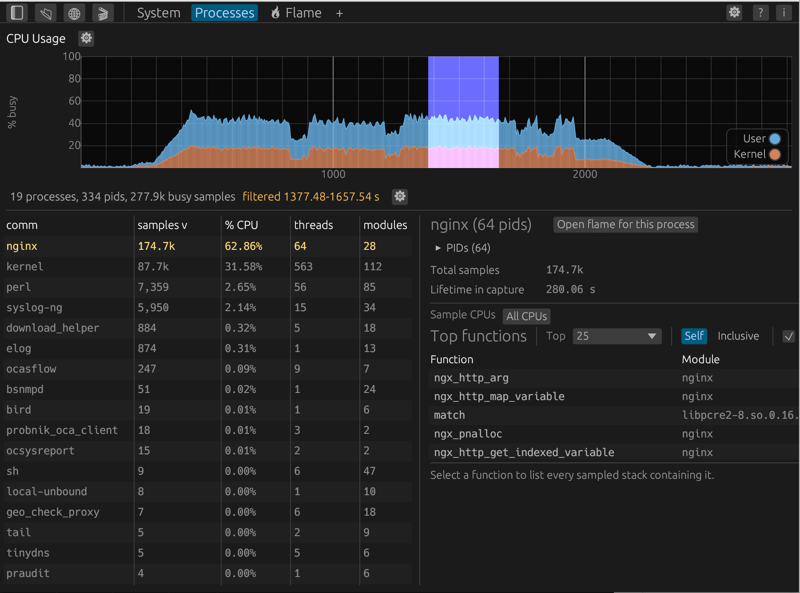

- **🔥 Flame** — interactive CPU stack flame graph. Only shown when the
  capture contains `cpu` provider data. See [CPU flame graph](#cpu-flame-graph)
  below.
- **Annotated source tabs** — opened by right-clicking a resolved function in
  Processes or Flame. The source view opens centered on the hottest sampled
  line; the **←** and **→** buttons jump to the previous and next source line
  that has samples. Firmware-tree files need `firmware_repo` in the
  [site config](site-config.md).
- **`+`** — opens the Session List tab, where you can add TCP session
  or Fanout channel tabs. Shown whenever there is at least one TCP
  session, Fanout channel, or nginx request list. It sits after the
  fixed tabs, and everything opened from it lands to its right.
- **Per-session tabs** — one per open TCP session or Fanout channel, in the
  order they were opened.
  - Left-click a tab to focus it.
  - Middle-click (or the small `x`) to close it.
  - Right-click a TCP tab to rename it inline; press Enter to apply, or leave the box
    empty to restore the default `Session <id>` label.
- **⚙ display options** — right-aligned, left of **?** and **i**.
  Dark, UTC, plot legends, and time buckets. These apply across every tab.
  - **UTC** — switches every time axis and cursor tooltip (per-session
    panels, the System tab, and the CPU strips) from seconds-since-capture
    to absolute UTC clock time. Axis ticks read as a bare `HH:MM:SS` (or
    `HH:MM:SS.mmm` once zoomed in past one second); the `UTC+` prefix
    appears just once, anchored to the left edge of whatever's currently
    visible, rather than on every tick. The next grid tick under that
    wider label is omitted so the two don't overlap. Cursor tooltips
    always carry the `UTC+` prefix. Only has an effect when the loaded
    capture's header includes a wall-clock start time.
  - **Dark** — also on the splash page. egui dark palette (on by default).
    Remembered in `~/.config/event_explorer/` on desktop and
    `localStorage` in the browser. Uncheck for light.
  - **Legends** — show the per-plot colour key on every plot, at the
    bottom-right. On by default; turn off to reclaim space or when a
    legend covers data.
  - **Time buckets** — how many equal-time buckets each time-series
    plot uses across the visible window (default 250, range 20–2000).
    Zooming re-bins at the same count. CPU Usage, session RTT, and
    session Rate use this count. Remembered across launches
    (`plot_bins` under `~/.config/event_explorer/` on desktop,
    `localStorage` in the browser).
- **(?) plot help** — right-aligned, immediately left of the tab-bar
  gear. Mouse and keyboard for time plots (box zoom, undo, reset, Δt,
  Y-max, legend, sizer, maximize). Flame-canvas gestures stay on that
  tab's own **?**.
- **ⓘ trace info** — right-aligned, immediately right of the tab-bar
  gear. Opens a popup with file-wide metadata: capture start/end/duration
  and event counts, a providers table grouped by name (provider count,
  sessions, events, size), per-interface TX/RX byte totals, per-stack
  TCP session counts, Fanout instance/title/session peaks, and
  STARS/HPTS sample counts — whichever sections apply to the loaded
  capture. **More details...** on the Providers heading opens an Events
  tab: every event id in the capture (providers that share a name are
  combined), with record and payload sizes,
  share of the file, rate, and (when the capture embeds a decode schema)
  level, keywords, and per-field sizes.

  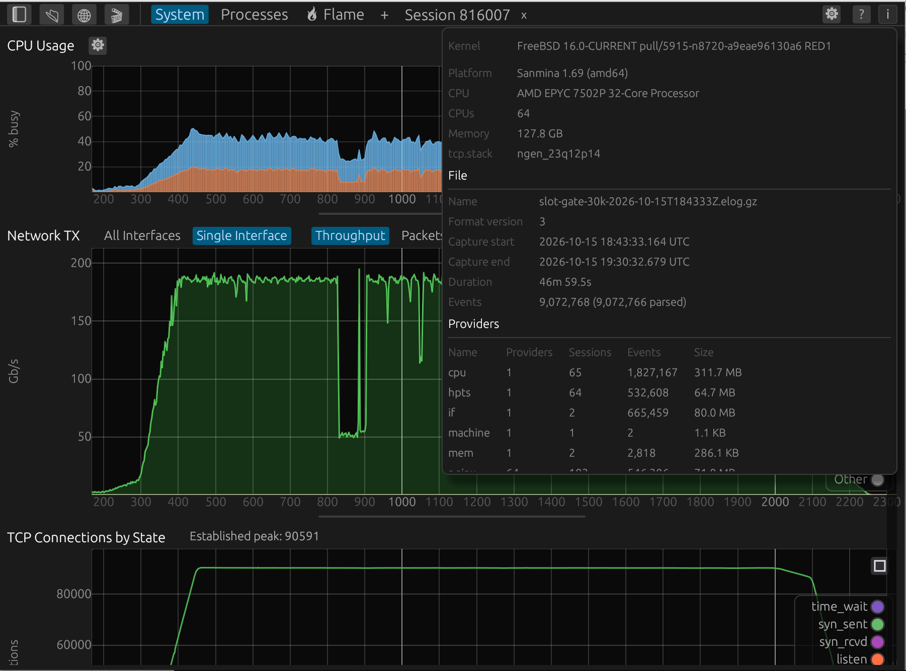

Per-interface throughput (`if` provider) lives on the System tab (All
Interfaces and Single Interface). Per-stack TCP histograms, STARS, and
HPTS are on that same tab, hidden by default until
you enable them in the plot catalog. TCP Connections by State and the
Fanout Relay Subscribers / RX and Fanout Server TX rows are on by default.

A capture with only one TCP session and no System catalog content skips
straight to that session's view; `+` is still on the bar if you want the
list. If System is shown (interface TX/RX, HTTP RPS, TCP PCB-state
gauges, or the hidden-by-default plots), the app lands on System and
`+` opens the session. Cpu-only captures (e.g. those produced by
`oca.py get profile`) skip straight to the Flame tab.

## Plot catalog

The sidebar button (left-sidebar icon next to **Open File**) opens a
left sidebar listing that tab's plots (System, a TCP session, or a Fanout
channel). Other tabs show a short "no configurable plots" note.

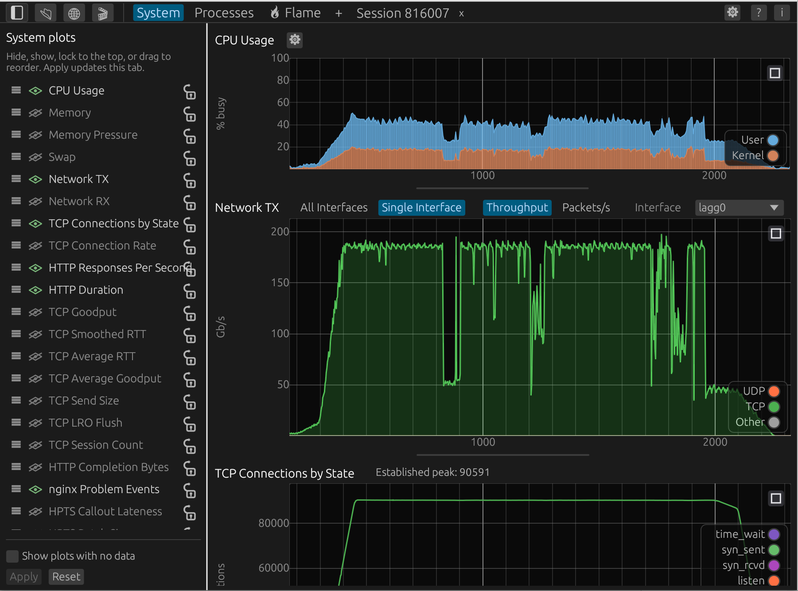

Each row has a drag handle, a hide/show control, a **lock** control on
the right, and the plot name. Locking pins that plot above the tab's
scroll so later plots move underneath it. Locking a row also locks
every plot above it; unlocking a plot unlocks every row after it.
Plots with no data in this capture are omitted from the list. Check
**Show plots with no data** (footer, off by default) to list them
dimmed; drawing still no-ops. A long list (System, after Fanout split
into per-plot rows) scrolls; **Apply** / **Reset** stay at the bottom.
Toggles and drags edit a **draft**. **Apply**
copies the draft onto the live layout for this tab only and redraws.
**Reset** restores that tab kind's defaults. Switching tabs keeps each
tab's own draft and applied layout.

Default-shown System plots: CPU Usage, Network TX, TCP
Connections by State, Fanout Server TX, Fanout Relay Subscribers, and
Fanout Relay RX. Nothing is locked by default. Everything else starts
hidden.

Default-shown session plots: RTT, Rate, Send State, Sizes, Size
CDF. When present, HTTP Requests, HTTP Response Size, and HTTP
Duration are also available in the catalog. CPU Usage, Network TX,
and Network RX sit at the top of the session catalog, hidden and
unlocked by default.

## Session list

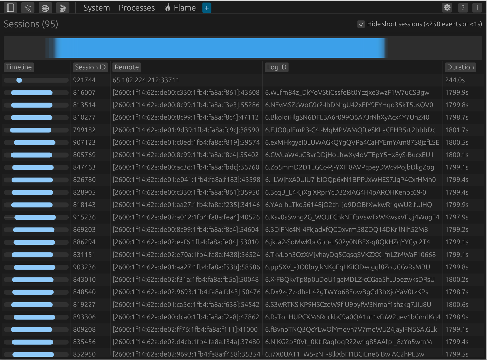

A sortable table with one row per TCP session:

| Column | Meaning |
|--------|---------|
| Timeline | Bar of the session's lifetime on the full trace span; the brighter inner segment is the byte-weighted active window, so long idle tails show. Sorts by start time. |
| Session ID | 64-bit session id. |
| Remote | Remote `IP:port` from `EVT_CONN_SET_IP_V4` or `[addr]:port` from `EVT_CONN_SET_IP_V6`, or `(unknown)`. |
| Log ID | Connection log identifier string when present. |
| Duration | Wall time from first to last event (seconds). |
| Bytes Sent | Cumulative bytes sent / acknowledged. |
| Goodput | Average kernel goodput in Mb/s. |
| Pacing Rate | Average pacing rate in Mb/s. |
| RTT | Average smoothed RTT in milliseconds. |
| Min RTT | All-time minimum RTT observed in milliseconds. |
| Events | Number of parsed events in the session. |
| Recovery | Number of `EVT_ENTER_RECOVERY` events. |
| HTTP Reqs | Number of HTTP requests logged on this connection (when nginx telemetry is present). |

Click any column header to sort. Click a row to open (or switch to) that
session's per-session tab. When the capture also has Fanout channels, that
table sits below the TCP sessions (both stay on-screen; a long TCP list
scrolls inside its pane).

Above the table, an overview minimap draws every listed session's lifetime
on one trace-wide lane — overlaps darken, so busy stretches and quiet gaps
read at a glance. Drag across it to filter the table to sessions
overlapping that time window (the window shows below the strip); click the
strip or the ✕ to clear. Hovering the strip or a row's Timeline bar shows
the trace-relative (and UTC, when enabled) times.

When the capture also has `fanout_node` / `ella_relay` channels, a second **Fanout
channels** table lists them grouped by channel name (reincarnated
sessions fold into one row). It uses the same sortable header buttons as
the TCP session list. Columns: **Node** (Server / Relay, from `NODE_INFO` when the producer
emits it, else inferred from `INSTANCE_ATTACH`), compact channel **IDs**, short **Channel** name, full **Name**
(path and query), duration, **Clients** (peak live subscribers),
**Rate** (typical object Mbps, time-weighted mode: **TX** on Server,
**RX** otherwise; `-` when matching `OBJECT_STATE` is absent), **Frame**
(byte-weighted frame Mbps: actual send on Server, recv on Relay), **Stretch**
(fraction of frames slower than 1.25× the reference: actual vs planned
on Server, recv vs wire on Relay; `-` without `FRAME_SAMPLE`), **Instances**, **Errors** (`CHANNEL_ERROR`
count for that title), and **Events**. A title carried by both nodes is
one row reading `Server + Relay`, with each column summed or peaked
across them. Click a row to open that title's tab: occupancy over time
(Internal and External on one Subscribers plot, split per instance when
four or fewer of them touched the title on that node).
The channel-tab header names the nodes when the capture has more than
one `fanout_node` provider.

**Hide short sessions (<250 events or <1s)** toggles a filter that hides
sessions below those thresholds. This also affects the System tab's CDFs
and count plots.

## System tab

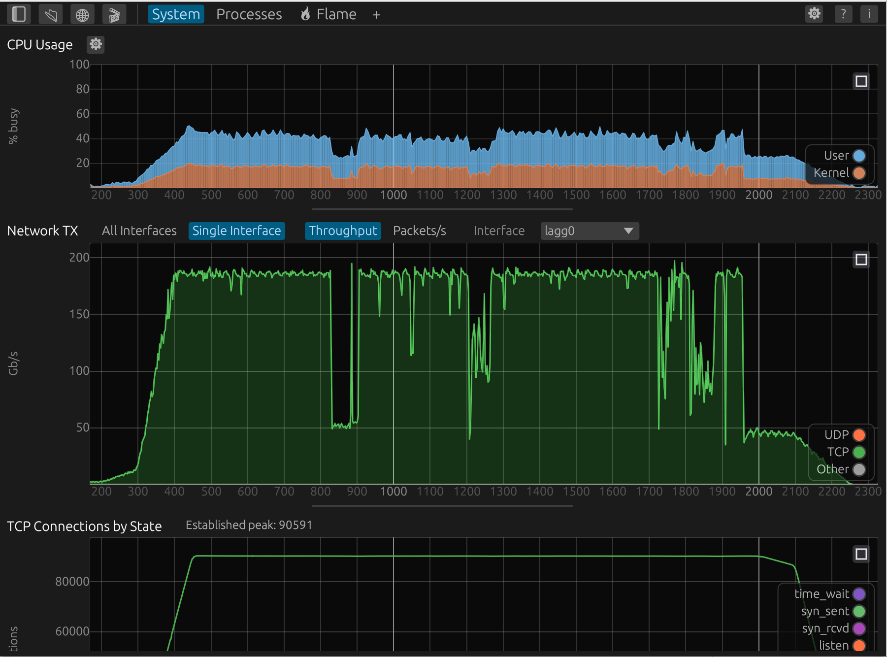

The System tab shows file-wide context. The [plot catalog](#plot-catalog)
controls order and which panels are shown. Defaults: **CPU Usage**,
**Network TX**, **TCP Connections by State**, and
**Fanout Server TX** / **Fanout Relay Subscribers** / **Fanout Relay RX**
are shown; the rest start hidden, in this catalog order:

- **CPU Usage** — stacked **Kernel vs User** busy time by default
  (gear: Aggregate, Per-CPU, Per-Process, **Scale by CPU frequency**
  on, **Zoom to time window** on). Y-axis is **% busy**, never
  above 100. Zoom to time window follows this tab's box zoom and
  re-bins the visible span; turning it off shows the whole capture
  with that window highlighted, and dragging the plot sets the window.
  Kernel vs User and
  Per-Process cursor tooltips include Kernel, User (or each process),
  and a **Total** row. The **Sample CPUs** filter in Flame / Top functions
  also applies to every CPU Usage plot and display mode; 100% means the
  selected sampled CPUs are fully busy. The same plot is available on a
  per-session tab (sidebar, hidden by default) and the Flame canvas. Only shown when
  the capture has `cpu` provider samples.
- **Memory** — the `mem` provider's system page states stacked in GiB,
  bottom to top: Wired, Active, Inactive, Laundry, **Other**, Free.
  Other is usable memory minus the five sampled states, so the top of
  the stack is the usable total. The legend sits on the plot. The **?**
  next to the title explains each band.
  Hidden by default.
- **Memory Pressure** — free pages (GiB) against the pagedaemon free
  target / min / severe thresholds, on a scale that fits those four
  lines. Starts hidden.
- **Swap** — swap in use (GiB), total in the title. Hidden until
  enabled in the catalog.
- **Network TX** / **Network RX** — separate catalog rows. TX is on by
  default; RX starts hidden. Each plot opens on **Single Interface**
  (TCP/UDP/Other stacks); **All Interfaces** is one line per NIC.
  The choice sits on the same line as the title and the
  **Throughput** (Gb/s, or a smaller unit when the visible peak is under
  1 Gb/s) / **Packets/s** toggle. On TX, **Show Network Errors** sits
  to the right of the Interface dropdown and draws TX queue drops
  (`oqdrops`) on this plot. It is grayed out when that interface
  recorded no input/output errors and no queue drops (in All
  Interfaces, when none of the active NICs did). See
  [Network Interfaces](#network-interfaces).
- **HTTP Responses Per Second** — completed nginx responses per second,
  one line per status class (`2xx`, `4xx`, …), from `NGINX_SAMPLE` when
  the capture has it and otherwise from `REQUEST_DONE`. **TCP** is
  `TCP_RPS_SAMPLE` (all stacks summed) and starts off in the legend
  when response lines are drawn. TCP stays on when it is the only
  series. Un-hidden when the
  capture has nginx data or a `TCP_RPS_SAMPLE` rate series (at least two
  monotonic samples). A single startup sample does not count. Binned
  into the Time buckets count (default 250) over the visible window
  (same count as the other stacked System plots).
- **Connections by PCB State** — the subsystem-wide `TCP_SAMPLE` gauges,
  every kernel PCB state on one shared-axis time plot: `established` (which
  dominates by one to three orders of magnitude) plus each of the other ten
  states as its own line (`closed`, `listen`, `syn_sent`, `syn_rcvd`,
  `close_wait`, `fin_wait_1`, `closing`, `last_ack`, `fin_wait_2`,
  `time_wait`). These are the machine-wide aggregate across every TCP stack
  and VNET, not any one stack. Toggle a state off in the legend to rescale
  the y-axis onto the smaller lifecycle states that `established` otherwise
  dwarfs. Only shown when the capture carries `TCP_SAMPLE` data.
- **TCP Connection Rate** — established vs torn-down connections per
  second from the same `TCP_SAMPLE` PCB gauges as TCP Connections by
  State. Consecutive ticks pair `Δestablished` with the closing states
  (`fin_wait_*`, `close_wait`, `time_wait`, …) so a flat established
  count with growing `time_wait` still shows churn. Binned into the
  Time buckets count (default 250) over the visible window (same count
  as HTTP RPS). Hidden by
  default; enable it in the catalog sidebar.
- **HTTP Duration** — mean `REQUEST_START` → `REQUEST_DONE` (milliseconds)
  in the Time buckets count (default 250) over the visible window, same count as HTTP responses
  and HTTP Completion Bytes. Two lines: **Small** (< 5K bytes) and
  **Large** (≥ 5K). Un-hidden when the capture has nginx data; the
  header shows each class's mean in the current window.
- **nginx Problem Events** — per-bin counts of nginx diagnostic events
  (TLS handshake failures, abnormal request completions, upstream
  attempt failures, sendfile EBUSY deferrals and errors, file-open
  failures, blocking aio reads, worker stalls), the Time buckets count
  (default 250) over the visible window. Listed in the catalog only when the capture has any
  of those events (firmware with the nginx diagnostic events).
- **HTTP Completion Bytes** — `REQUEST_DONE.bytes_sent` as Gb/s
  (same unit as Network TX/RX), the Time buckets count (default 250)
  over the visible window.
  Hidden by default; enable it in the catalog sidebar.
- **Origin Segment Rate** — ground truth video segment bitrates (Mbps)
  or segment sizes (MB) loaded from one or more origin segments CSVs
  (e.g. `origin-segments-*.csv`). Timestamps (e.g. `us-east-1` dual
  encoder `enc1` and `enc2`) are aligned to the capture's UTC anchor
  (`start_utc_us`). Rows inside the capture are plotted on the shared
  System time axis; rows outside it are skipped, including when a file
  crosses UTC midnight or only partly overlaps. A file with no rows in
  the window stays loaded and names its span. Load via command line
  (`event_explorer capture.elog day1.csv day2.csv`), the top-bar 🎬
  button, drag-and-drop, or the file open dialog.
- **TCP Average RTT** — per-session average SRTT, split paced vs not
  paced. **Over Time** (default) is the mean per-session average across
  the sessions active in each of the Time buckets (default 250) over the visible window
  (same count as HTTP RPS), with per-class means in the header. Buckets
  with no active session are gaps, not zeros. **Distribution** is a CDF
  plotted on a "nines" percentile x-axis (the axis stretches toward 100%
  so tail percentiles are readable), with P50 / P95 / P99 summary text.
- **TCP Average Goodput** — same two views as TCP Average RTT, for avg
  kernel goodput per session. Over Time is the default.
- **TCP Session Count** — step curves of the number of concurrent
  active sessions, split into **Paced** (avg pacing rate > 0) and
  **Not paced**. Caption includes peaks, total duration, and counts per
  bucket. Only shown when the capture has per-connection sessions.

Hovering any time-series panel (the CPU strip, NIC rate, session count,
Network TX/RX, HTTP Responses Per Second, HTTP Duration, TCP Connections by State, or TCP Connection Rate) draws a shared vertical cursor line down **every** such
panel, so the same instant lines up across the whole tab. Tracking dots and
a value tooltip are shown for just the panel under the pointer and change as
you move between panels, so each reads on its own without one giant combined
list. Legend-hidden series are omitted from the tooltip. The TCP Average
RTT / Goodput panels join the shared cursor in their **Over Time** view;
in **Distribution** view they keep their own per-plot tooltip, since
their x-axis is a percentile rather than the capture clock.
The same **Hide short sessions** filter that acts on the session list also
rebuilds the session-derived aggregates.

All System panels stack in a single vertical scroll and share a
left-aligned y-axis gutter. The mouse wheel scrolls the tab (individual plots
don't wheel-zoom); instead every time-series panel shares **one zoomable time
window**, so a gesture on any of them re-scopes the whole tab at once:

- **Box zoom** — left-drag horizontally across any time panel; on release
  every time panel (including CPU Usage) zooms to that time span. Releasing
  off the plot (or off the window) clamps to the visible edge, so a drag
  from mid-plot out to the right of the screen zooms through the end of
  the current window.
- **Slide window** — Shift+left-drag moves a zoomed time window without
  changing its width. On Flame, the same gesture slides the CPU Usage
  highlight.
- **Undo** — double-click to step back through the zoom history one level.
- **Reset** — after undoing the last zoom, double-click again to restore
  the full capture.
- **Δt measurement** — right-drag to highlight a span; an orange band with a
  `Δt = …` readout is drawn across the panels and persists (anchored to that
  time range) until you start another measurement. Shift+right-drag slides
  that band without changing its width. The readout stays at the
  top of the visible area as you scroll.

The System tab's zoom window stays in sync with the Flame tab: switching
to Flame carries over whatever sub-window System is zoomed to (full
capture if un-zoomed), and leaving Flame writes that selection back onto
System. Session and Fanout channel tabs keep their own zoom; switching
among those (or to System) does not copy a time range. The percentile-x
CDFs and the whole-capture goodput histogram are categorical, not time,
so they stay out of the System tab's shared window and keep their own
local tooltips.

High-level NIC TX/RX (Single Interface by default, or All Interfaces)
are described under [Network Interfaces](#network-interfaces) below; the TX
panel (with CPU Usage) is the System-tab default, plus TCP
Connections by State and the Fanout Server TX / Fanout Relay Subscribers /
Fanout Relay RX rows when those have data. HTTP Requests
per Second, session CDFs, per-stack TCP histograms, NIC RX, the other
Fanout rows, HTTP
completion bytes, STARS, and HPTS share this scroll and this time axis;
they start hidden.

The remaining subsections describe those panels.

### Fanout

When a capture contains `fanout_node` or `ella_relay` occupancy
samples (`CHANNEL_COUNT` and/or `CHANNEL_COUNT_TOTAL`), `OBJECT_STATE`
events, or detailed `FRAME_SENT` / `FRAME_RELAY` events, each Fanout
plot is its own [plot catalog](#plot-catalog) entry: **Fanout Server
TX / RX / Frame Send / Frame Duration / Frame Ratio / Errors** and
**Fanout Relay Subscribers / RX / TX / Frame Send / Frame Duration /
Frame Ratio / Channels / Errors**. Shown by default: Server TX, Relay
Subscribers, and Relay RX; the rest start hidden. The Server has no
Subscribers or Channels rows — a co-located relay is usually its only
subscriber, so those read as noise. Plots prefer per-instance
`CHANNEL_COUNT` (`STATS_DETAILED`, removed by ELLA PR #481) when any
samples exist; otherwise they use process-wide `CHANNEL_COUNT_TOTAL`
(`STATS`). Two `fanout_node`
providers (ella_server + mrelay) draw one widget per node under the
row, headed **Fanout — Server** / **Fanout — Relay**; Internal /
External stay faces inside each node. A
single-provider capture keeps one widget per row under that node's
role. Unlabeled nodes follow the Relay rows.

Every plot below is per node, under that node's heading, with its own
palette range. Line plots are binned into equal-time buckets over
the visible window (the tab-bar **Time buckets** slider, default 250;
the same model the channel tabs use), so zooming re-bins instead of
revealing pre-decimated points. A title carried by
both Server and Relay is a band on
each node's per-title stacks; clicking either opens the one tab that
covers both.

- **Fanout Subscribers** (Relay row) — a stacked area of downstream occupancy per
  title. When the capture has `CHANNEL_SAMPLE` (ELLA PR #481), each
  band is that title's sampled live `subscribers` (upstream instances
  omitted). Older captures replay `SUBSCRIBED` until `UNSUBSCRIBED` or
  that instance's `CHANNEL_DESTROYED`. Bands are short names
  (reincarnations of the same title share a band), busiest at the
  bottom. The color key and cursor tooltip list the same titles from
  highest peak occupancy to lowest. Origin / loopback clients are omitted — on a co-located
  ella_server that leaves the Server with no bands at all (its only subscriber
  is the relay on `127.0.0.1`), which is why the Server side has no
  Subscribers row. Hover a title in the color key for the
  Session List Rate (typical object Mbps) and this node's External peak
  and time-weighted average occupancy; click to open that channel's
  tab (same longest-reincarnation pick as the Session List). Color is by
  title, shared with Fanout RX / TX. Per-title stacks have no plot
  legend (the color key and cursor tooltip name the bands). A node with
  occupancy samples as well carries an **Aggregate / Per channel**
  selector (default **Per channel**), where **Aggregate** is that node's
  sampled live `clients`: one line per Fanout instance when there are
  four or fewer, otherwise **Internal** vs **External** (external is
  summed live clients). The selector setting is shared, so flipping it
  on one node flips it on the other.
- **Fanout RX** / **Fanout TX** — stacked object Mbps per title, the
  System-tab sum of the RX and TX lines on every channel tab's **Object
  Rate** plot. `CHANNEL_SAMPLE` `object_bytes` over each tick when
  present (empty ticks inherit the span from the previous non-zero
  sample, unless that span is longer than a GOP); otherwise
  `OBJECT_STATE` `bytes` over STARTED→COMPLETED (or ABANDONED),
  GOP-boundary hold under 50 ms, one copy per Fanout
  instance. Title order matches
  Subscribers (peak occupancy, highest first). Hover a title for the
  Session List Rate plus External peak/avg occupancy; click to open
  that channel's tab (same title colors as Subscribers). A Server
  contributes to TX only, since its single instance is downstream.
- **Frame Send** — byte-weighted FDACE Mbps summed across titles
  (`FRAME_SENT` / `FRAME_RELAY`, or `FRAME_SAMPLE`). Origin **Actual**
  and Relay **Wire** start on; Planned / Recv / Fwd start hidden.
- **Server Frame Duration** / **Relay Frame Duration — Internal** /
  **External** — mean per-frame milliseconds from the same events
  (`sum_*_us / frames`). Origin is Planned vs Actual; relay is Wire /
  Recv / Fwd. The y-axis follows the visible series (not pinned at 0).
  All series start visible. Intercept is Recv or Fwd holding a few
  milliseconds above Wire while Wire tracks a smaller object.
- **Server Actual Send Duration / Planned Send Duration** — Median, P75,
  P95, and Max of `FRAME_SENT actual_send_us / planned_send_us` in 100 ms
  bins. **Max** starts hidden in the legend. The y-axis follows the
  visible series (not pinned at 0).
- **Relay Receive Duration / Server Send Duration — Internal** and
  **External** — separate percentile plots for the two Fanout instance sides.
  **Max** starts hidden and the y-axis follows the visible series, same as
  the server ratio plot. Each uses `FRAME_RELAY recv_us / wire_send_us` in
  100 ms bins; `wire_send_us` is the server-stamped packet-send span. Without detailed events, the UI
  visibly labels a **`FRAME_SAMPLE fallback`**: it first sums each
  channel/instance's sample timing totals into 2 s windows, then calculates
  percentiles across those aggregate ratios. The fallback approximates a
  continuously sent object but is not a per-frame distribution.
- **Fanout Channels** (Relay row) — two plots, **Upstream** then **Downstream**.
  Each combines that side's channel-table size with its leave-delay queue
  (origin LEAVE held until the delay expires) and retire-at-boundary
  queue. On aggregated `CHANNEL_COUNT` captures the Downstream plot has a
  **Max / Sum** toggle (default **Sum**) for those three series. A
  `CHANNEL_COUNT_TOTAL`-only capture uses the process-wide up/dn series
  (leave/retire per side; Max/Sum is hidden). If occupancy samples end
  before the rest of the capture, the lines stop there and a caption
  notes the last sample time.
- **Fanout Errors** — one cumulative line per `NODE_ERROR` /
  `CHANNEL_ERROR` code. PR #470 captures split CAT/JOIN failures into
  distinct node-error codes instead of a coarse `JOIN_REJECTED` line.

These panels share the System tab's time axis.
Per-channel detail plots live on Fanout channel tabs opened from the
Session List (`+`) or a Subscribers / RX / TX color-key click.

### Fanout channel tabs

A channel tab covers one title, drawing every reincarnation of it on
each node that carried it, on the same capture-wide time axis as System
(the Session List groups reincarnations; click opens the longest).
Merged files and sequential lives of the same title stay on one
timeline; occupancy drops to 0 in the gaps. The header is a short name plus a stats strip
(nodes when the capture has Server and Relay, peak live clients,
duration, end state, channel ids, version). **Subscribers** is one plot:
**Internal** and **External** lines, split per instance (`Internal i3`)
once a side runs more than one of them on that node and four or fewer
touched the title. Occupancy is `CHANNEL_SAMPLE` when present, otherwise
`SUBSCRIBED` / `UNSUBSCRIBED`. Lifecycle glyphs are not drawn
on the occupancy y-axis. **Object Rate** is **Server**, **Internal**,
and **External** Mbps. With `OBJECT_STATE` that is `bytes` /
STARTED→COMPLETED: Internal is the ingest instance and External is the
worker selected on Object Timeline (Median / P75 / P95 / Max). With no
`OBJECT_STATE`, the plot uses `CHANNEL_SAMPLE` `object_bytes` over each
stats tick (an empty tick inherits the previous non-zero sample).
Capture-hole intervals are dropped.
**Object Timeline** has three lanes (**Server**, **Relay Internal**,
**Relay External**; Server on top). Color flips each GOP
(`FRAME_SENT` ids, relay via `first_pn`). External has a **Median / P75 /
P95 / Max** selector (default Median) for which worker is drawn.
Internal is the ingest instance. A bar is STARTED until the next
object's first packet. A STARTED that
only completes after a capture hole is not drawn as one long block.
The block after a skipped id is red; the first object after a quiet
gap is not.
**Frame Timeline** appears when the title has `FRAME_SENT` /
`FRAME_RELAY` (not the 2 s `FRAME_SAMPLE` fallback). Same three lanes
and GOP colors as Object Timeline. One bar per FDACE
frame. Server Actual is `[event timestamp − actual_send_us, event
timestamp]` when `FRAME_SENT` is emitted per-frame at frame-end; a
legacy GOP-end burst (all frames sharing one timestamp) is still laid
from object STARTED. Internal and
External bars are Recv (first-to-last packet at that instance). Hover
uses the `FRAME_SENT` object id. Adjacent frames in a GOP alternate
light/dark teal or purple. Dropped events show as gaps.
**Object Duration**
is STARTED until the next object's first packet: Server and Internal
are that face's copies; External draws Median, P75, P95, and Max across
workers of that GOP (only Median starts on).
starts on).
A skipped GOP reads as ~4s or ~6s; packet stretch inside a GOP is Frame
Duration. Trailing teardown drops are omitted so the y-axis stays
on typical GOPs. It drops to 0 when the node has no live object.
**Object Size** is that GOP's payload in **MB**, with the same Server /
Internal / External split (External Median on by default).
It also drops to 0 between lives.
Timeline, Duration, and Size default
to half the usual plot height. Line plots (Subscribers, Object Rate,
Frame Rate, Frame Duration, Duration Ratio, Object Duration, Object
Size, Errors) use the Time buckets count (default 250) over the visible window, same count as
System HTTP RPS. A step-series hold covers every overlapping bin, so
a frozen occupancy gauge stays flat instead of dropping to 0. **Frame Rate** is byte-weighted FDACE Mbps from
`FRAME_SENT` / `FRAME_RELAY` when present, otherwise `FRAME_SAMPLE`.
Origin and relay sit on
separate plots when both nodes are on the tab
(**Server Frame Rate** / **Relay Frame Rate**); a single-node tab
keeps one **Frame Rate** plot. Origin **Actual** and Relay **Wire**
start on; Planned / Recv / Fwd start hidden in the legend. The frame
rate y-axis follows the visible series instead of pinning 0. On the
relay plot, **Wire** is the origin send duration carried in the
packet headers, **Recv** is first-to-last packet arrival at that
instance, and **Fwd** is first-to-last forward to clients or workers;
Mbps is frame bytes over that duration (stretch is a drop). Origin
`FRAME_SENT` is per-frame at frame-end on current Ella; older captures
still burst at GOP-end (~2s cadence), so a gap there is not
a stall. **Frame Duration** is mean per-frame milliseconds from the
same events (origin Planned/Actual; relay Wire/Recv/Fwd). Server and
relay sit on separate plots when both nodes are on the tab
(**Server Frame Duration** / **Relay Frame Duration**); the y-axis
follows the visible series. All duration series start visible.
**Duration Ratio** is the per-channel version of the System
ratio plots: Median, P75, P95, and Max of `FRAME_SENT`
actual/planned (server) or `FRAME_RELAY` recv/wire (relay),
the Time buckets count (default 250) over the visible window, split **RX** / **TX** by instance
side. It prefers the detailed
frame events and only falls back to `FRAME_SAMPLE` 2 s per-instance
aggregate ratios (labeled) when the channel has no frame events.
**Max** starts hidden and the y-axis follows the visible series.
Server and relay sit on separate plots when both nodes are on the
tab (**Server Duration Ratio** / **Relay Duration Ratio**).
**Errors** is a cumulative line
per `CHANNEL_ERROR` code for that channel session. Plots scroll vertically
when they do not fit.

On a capture with both nodes, every series here is named
`<node> - <side>` (**Relay - External**, **Server - TX**) and gets its
own color, so the Server's and the Relay's view of the title sit on the
same axes. That puts a relay's fanned-out TX next to
its own ingest and the server's egress — a ~60× gap on a 65-instance
relay. Click the tall entry in the color key to hide it and the plot
rescales to the rest.

### Network Interfaces

When a capture contains `if` provider data (see
[file-format.md](file-format.md#if-provider-event-id-catalog)), a
**Network Interfaces** panel appears on the System tab, in one of two
modes. Each of **Network TX** and **Network RX** has its own
**All Interfaces / Single Interface** selector on the title row, next
to that plot's Throughput / Packets/s toggle. **Single Interface** is
the default. The selector is hidden
(and that plot stays in All Interfaces mode) on captures where no
interface has any TCP/UDP/other data to show — deprecated `IF_SAMPLE`
captures, and files where every active interface happens to be
carrier-only (see below).

**All Interfaces** is a multi-interface comparison of
all-protocol totals — "which NICs are busy":

- **Metric selector** — toggle the TX/RX plots between **Throughput**
  and **Packets/s**. Throughput is labeled in Gb/s, Mb/s, Kb/s, or
  b/s, whichever keeps the visible peak at least 1.
- **TX (transmit)** and **RX (receive)** plots — one line per active
  interface (idle management NICs are left off the plots), derived by
  diffing the cumulative byte/packet counters over the sample period and
  lightly time-smoothed to absorb NIC counter-refresh jitter. Each plot's
  legend doubles as a hide/show toggle — click a name to drop it from the
  plot (and its y auto-fit). The two plots share a linked time axis.
  **Show Network Errors**, on the Network TX header to the right of the
  Interface dropdown, adds a solid red line for each interface whose TX
  queue-drop counter (`oqdrops`, `IFCOUNTER_OQDROPS`) advanced. The
  checkbox is grayed out when the selected interface recorded no
  input/output errors and no queue drops; All Interfaces grays it out
  when no active NIC did. The **drops/s** name sits on the same line
  as the throughput axis name,
  and each drops tick label sits directly under the throughput tick at
  that height. The plot keeps the same left edge as the panels around
  it. The scale follows the visible window. Hiding a drops series in
  the legend takes it off the scale. Unchecking the box removes the
  lines and the drops labels.

**Single Interface** picks one interface and shows its TCP/UDP/Other
composition as an absolute (not percentage) stacked-area chart — "how does
this interface's traffic break down":

- **Interface picker** — on the same header row, after Packets/s. TX
  and RX pick interfaces independently. A dropdown of interfaces the IP layer actually
  classified traffic on, busiest first. Carrier-only interfaces (a `lagg`
  member port, a `vlan`'s underlying physical NIC, a `bridge` member) are
  omitted: `ip_proto_ifcount()` only ever sees the logical interface above
  them, so their TCP/UDP/Other would always be an empty stack. Their raw
  totals stay visible in All Interfaces mode.
- **Metric selector** — same Throughput/Packets·s toggle as above, applied
  independently to the TX and RX stacks.
- **TX** and **RX** stacked-area plots — Other (bottom), UDP, and
  TCP (top), stacked so the total height already equals the
  interface's all-protocol rate. The plot legend toggles each band. On a
  schema new enough to carry a direct `other` counter
  (appended `other_*` fields) the stack is self-consistent by construction; on an older
  schema `other` is derived as total minus TCP minus UDP — see
  [file-format.md](file-format.md#if-provider-event-id-catalog).
  The TX stack draws the same solid **drops/s** line as All Interfaces,
  for the selected interface. **Show Network Errors** sits to the right
  of the Interface dropdown.

On a typical OCA the physical NICs and their `lagg` aggregate dominate; per
member NIC the per-sample rate is bursty (RSS spreads flows), so each line is
mean-downsampled to the visible width. The interface metadata table and the
lifecycle/link/config change timeline are available from the CLI
(`elog_cli interfaces` / `ifevents`).

### TCP stack (per-stack samples)

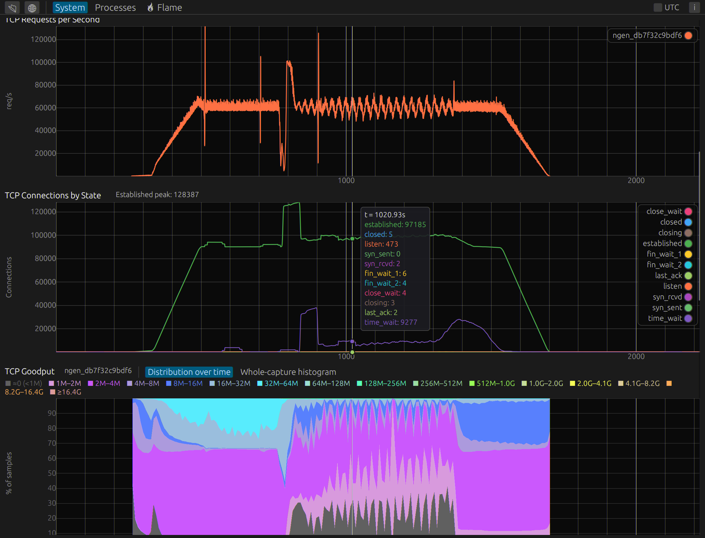

When a capture contains the `tcp` provider's periodic *per-stack* samples
(goodput, send-size, or smoothed RTT; ids 902–903, 906, and 908; see
[file-format.md](file-format.md#periodic-samples-900999)), those histograms
appear on the System tab, hidden by default. The TCP line on
**HTTP Responses Per Second** (`TCP_RPS_SAMPLE`) starts off in the
legend when nginx response lines are drawn, and is the plot's only
line when the capture has no nginx data. The subsystem-wide
PCB-state gauges (`TCP_SAMPLE`, id 900) — **TCP Connections by State** —
are on by default. LRO flush-size (`TCP_LRO_FLUSH_SAMPLE`, id 907) is
grouped with the other histograms.

A box registers one `tcp` provider per loaded TCP stack, and every stack
numbers its "global" session identically, so the samples are demuxed by
`(provider_id, session_id)`, not by session id alone (see
[file-format.md](file-format.md#periodic-samples-900999)). Each stack is
labelled by its `TCP_STACK_INFO` name where present, or `tcp#<provider>`
when it isn't — a stack streams samples but emits no `TCP_STACK_INFO` if it
was loaded *after* the collector subscribed (so no dump-on-subscribe
replayed its identity).

- **Goodput Distribution** — the per-connection goodput histogram
  (`TCP_GP_SAMPLE`, log2-Mbps buckets), shown only when the capture carries
  goodput-histogram samples. The panel title names the contributing stack(s)
  (goodput is a per-stack event). A selector switches between two views:
  - **Distribution Over Time** (default) — a stacked-area plot of each
    bucket's *share* (% of samples) over time, on the shared time axis. The
    visible window is binned into columns and the cumulative histogram is
    diffed at each column's edges. Bands run blue→teal→green (blue = low
    goodput, green by 256 Mbps), with alternating brightness so
    adjacent bands stay easy to tell apart. The color key lists every
    bucket that reaches at least 1% of any time column in the visible
    window, from the smallest range to the largest. The hover lists
    buckets that are at least 1% of that column, largest share first.
  - **Whole-Capture Histogram** — the aggregate bar chart over the whole
    capture.

  Bucket 0 is `flsll(0)` — a per-connection goodput estimate that truncated
  to under 1 Mbps (effectively idle, or no valid estimate yet), *not* the
  absence of a sample (the kernel only counts from active send paths). It's
  drawn as a muted gray bottom band labelled `≈0 (<1M)`; the **exclude ≈0
  (<1M)** checkbox drops it and renormalizes the remaining ≥1 Mbps buckets
  to 100% so the real-rate distribution isn't compressed by idle flows.

- **Send size** — the per-stack byte-weighted segments-per-burst histogram
  (`TCP_SEND_SAMPLE`, 64 linear buckets). Y-axis is **% of bytes**. Shown
  only when the capture carries send-size samples. The color key lists
  buckets that reach ≥1% of any visible time column, largest average
  share first. Hover lists buckets ≥1% of that column.
- **LRO flush size** — the machine-wide packets-per-flush histogram
  (`TCP_LRO_FLUSH_SAMPLE`, 64 linear buckets). Y-axis is **% of flushes**.
  Same color key and hover as Send size.
- **Smoothed RTT** — the per-stack smoothed-RTT histogram
  (`TCP_SRTT_SAMPLE`, 14 usec buckets: 0, `<512us`, then octaves from
  512us, tail at `>=1s`). Same Distribution Over Time / Whole-Capture
  Histogram selector as Goodput. Over time the Y-axis is **% of
  connections**; the bar chart's Y-axis is connection-seconds. Bands
  run green → yellow → red (low RTT → high RTT), so a shift toward red
  is slowing down and a shift toward green is speeding up. Goodput runs
  blue → teal → green, and the green end is the same green as a low RTT.
  The color key lists every bucket that reaches at least 1% of any time
  column in the visible window, from the smallest RTT to the largest.
  The hover lists buckets that are at least 1% of that column, largest
  share first.

### HPTS callout histograms

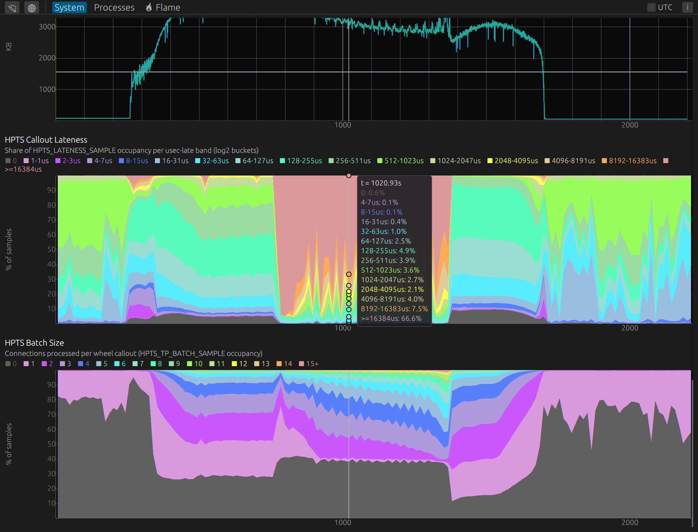

Captures carrying the `hpts` provider's periodic wheel histograms (ids
13/14) get two more stacked distributions over time, built by diffing the
cumulative per-instance snapshots. Hidden by default; enable **HPTS
Callout Lateness** or **HPTS Batch Size** in the
[plot catalog](#plot-catalog).

- **HPTS Callout Lateness** — how late each wheel callout fired relative to
  its requested slot, from `HPTS_LATENESS_SAMPLE`, bucketed into log2
  usec-late bands. Y-axis is **% of samples**.
- **HPTS Batch Size** — how many connections each callout processed, from
  `HPTS_TP_BATCH_SAMPLE`. Y-axis is **% of samples**.

Both histograms carry a bucket color key above the plot. The key lists
buckets that reach at least 1% of any time column in the visible window,
largest average share first. Hover lists buckets that are at least 1% of
that column, largest share first. The CLI equivalent is
[`hptslateness`](cli.md#hptslateness).

- **Slot Gate Output**, **Slot Gate Fires**, **Slot Gate Checks**, and
  **Slot Gate Rollover** — separate catalog rows from
  `HPTS_SLOT_GATE_SAMPLE`. Hidden by default.

### STARS

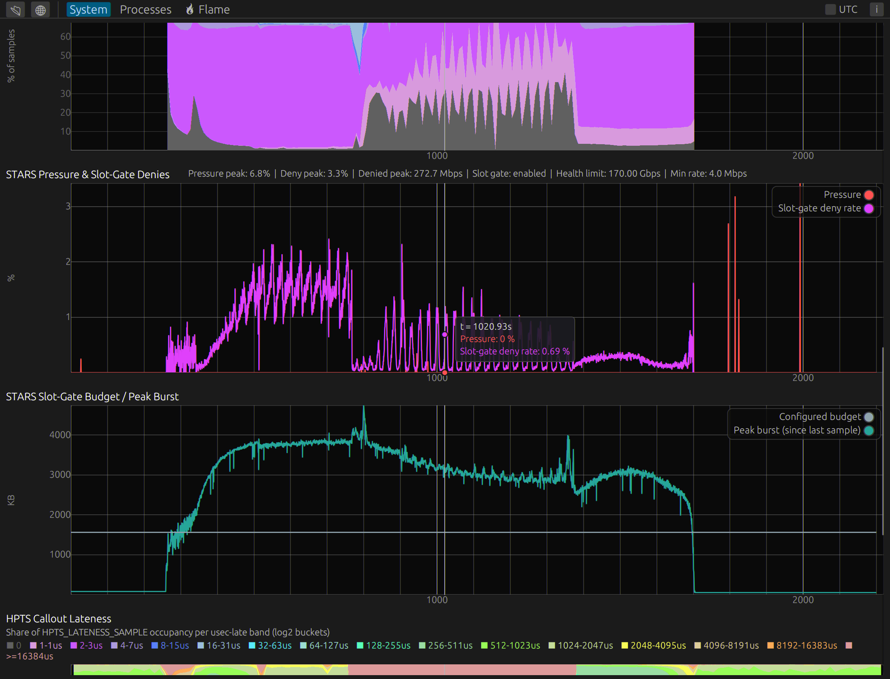

HPTS `STARS_AGG_SAMPLE` events (hidden by default; enable **STARS** in
the [plot catalog](#plot-catalog)): the STARS adaptive egress-rate-squeeze
controller's throttle pressure and slot-gate deny rate (0-100%) on one
panel, and configured budget vs. peak burst size (KB) on a second.
Peaks, denied throughput, and the config snapshot (health limit / min
rate / slot-gate enabled) are printed in the caption.

## Per-session view

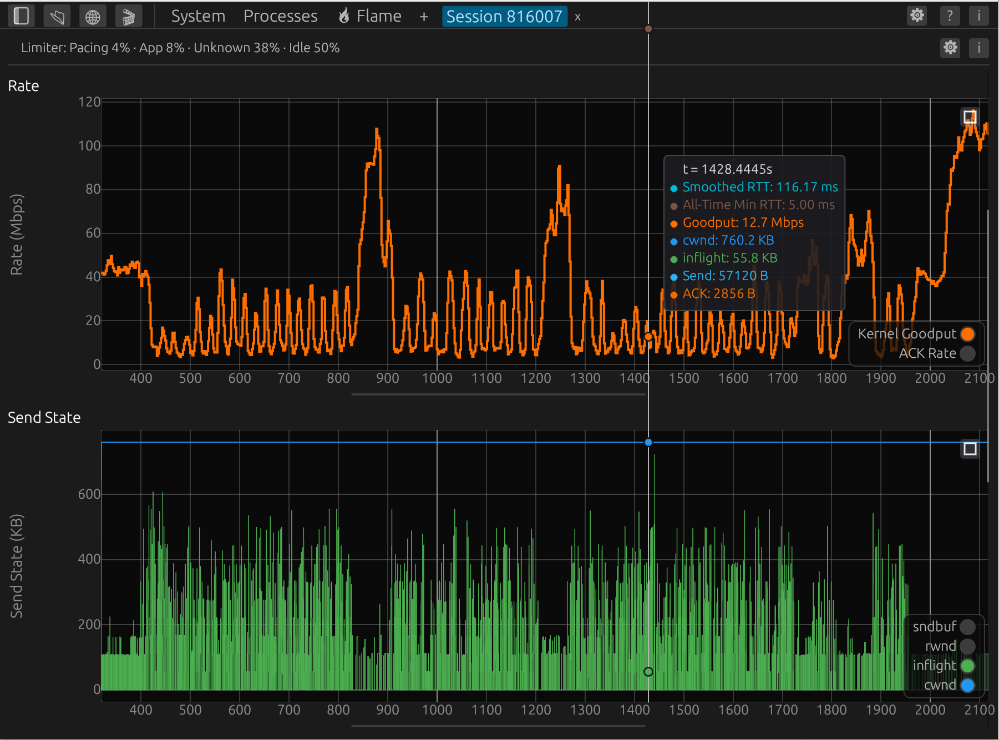

The per-session tab stacks five linked panels vertically. Order and
hide/show are controlled by the [plot catalog](#plot-catalog) (defaults
below). Maximize-one-plot still applies; a user-hidden panel stays off
even when it has data. Empty series still skip drawing.

| Panel | Series |
|-------|--------|
| **RTT** | Raw RTT, smoothed RTT, path RTT, all-time min RTT, goodput min RTT, goodput smoothed RTT. |
| **Rate** | Kernel goodput, pacing rate, and sliding-window ACK rate. Retransmits are surfaced on the Sizes panel (see below) rather than as a rate series — a sliding-window rate of a rare, bursty event is misleading (the centered window makes the curve start rising before the retransmit actually fires). |
| **Send State** | Congestion window (`cwnd`) and post-ACK bytes in flight (`inflight`) by default, plus three optional series — slow-start threshold (`ssthresh`), peer-advertised receive window (`rwnd`, tan line — only when the session has a `CONN_PARAMS_V2` event), and send-buffer backlog (`sndbuf`, cyan line — bytes queued to send but not yet in flight, from `EVT_USER_SEND`). The three optional series start hidden so the panel reads cleanly on first open; enable any of them from the legend. All five legend entries are sorted alphabetically. |
| **Sizes** | Send-size and ACK-size scatter plot. Retransmitted sends are split out and rendered in green (**RTX Size**) so you can see at a glance which OUTs were retransmits. Also hosts an optional **SACKed** step line (from `EVT_ACK.sacked`) showing outstanding sacked bytes — off by default; enable from the legend. Shares the byte-scale Y-axis with ACK/Send sizes, which matches the order-of-magnitude of SACKed in typical sessions. |
| **Size CDF** | Empirical CDF of send sizes (fresh + retransmit combined) and ACK sizes, recomputed from the currently visible time range. |
| **HTTP Requests** | Horizontal lanes for in-flight HTTP requests on this TCP session (when the capture has `HTTP_REQ_*` or nginx request events). |
| **HTTP Response Size** | One point per completed nginx request on this TCP session: x = completion time, y = `bytes_sent`, colored by status class (matching the HTTP Requests lanes). |
| **HTTP Duration** | One point per completed nginx response on this TCP session: x = completion time, y = `REQUEST_START` → `REQUEST_DONE` in milliseconds, colored by status class. |

The per-session tab title bar shows a one-line **Limiter** summary
(e.g. `Pacing 62% · CWND 18% · RWND 5% · App 11%`) giving the
time-weighted breakdown of what was limiting the sender during the
session. The same compact string is available via `elog_cli … summary
--limiter` and `elog_cli … limiter`.

To the right of the session title and limiter summary is a small **⚙
gear button**. Clicking it opens the plot overlay options menu. To its
right is the **i info button** (plain "i" glyph). Clicking it opens a
floating info panel on the right side of the window with:

- **Session** — session ID (decimal), remote IP:port, log ID string,
  duration, total bytes ACKed, mean goodput, and recovery count.
- **Connection parameters** (only when a `CONN_PARAMS_V2` event is
  present) — cc algo, snd/rcv window scales, and negotiated options
  (SACK, Timestamps, ECN, …).
- **Limiter breakdown** — full per-class percentage table including
  `cwnd`, `rwnd` (or `n/a` for legacy captures), `pacing`, `app`,
  `unknown`, and `idle`, matching what `elog_cli limiter` reports.
- **nginx connection** (only when the capture has nginx `CONN_*` / TLS
  events for this session) — port, TLS version / cipher / ALPN /
  handshake time and flags or the handshake failure, close reason,
  request and byte counts, and sendfile deferral / error counts.

Click the ⓘ button again to dismiss the panel.

The first four panels share a single time axis: zooming or panning any of
them updates all of them. The Size CDF's x-axis is percentile, not time, but
its *input data* is limited to whatever time range is visible in the other
four — so zooming into a burst in the Rate panel immediately reshapes the CDF
to match.

### Height sizer

Each plot that actually drew has an 8 px drag bar under it. Drag to
grow or shrink **that** plot; neighbors keep their own heights. Catalog
rows with no data (and hidden plots) do not get a bar. The tab
scrolls when the stack is taller than the window. A catalog row that
contains several plots (Fanout, STARS) still gives **each** plot
its own bar.

### Maximize

Each plot has a small expand button in its upper-right corner. Clicking it
hides the other plots on that tab (including siblings in the same Fanout
/ STARS block) and gives this one the remaining height
below its title / controls; click again (or press Escape) to restore.

## Interactions

All time-series panels share the same gesture vocabulary. The Size CDF has
its own simplified set (box zoom + double-click reset).

| Gesture | Action |
|---------|--------|
| Left drag (plot body) | Horizontal box zoom — select a time range to zoom into. Releasing off the plot clamps to the visible edge. Old range is pushed onto a per-session zoom history stack. |
| Shift+left drag | Slide the current zoom window without changing its width. On Flame, slides the CPU Usage time highlight. |
| Alt+left drag (Flame CPU Usage) | Set region A (orange band) and compare it against region B, the blue time-filter window — see [Comparing two time regions](#comparing-two-time-regions). Alt+right-click the band (or the chip row's ×) exits. |
| Double-click | Pop one level off the zoom stack. When the stack is empty, reset all axes. |
| Middle click | Reset zoom (full capture). Middle-drag does not pan. |
| Right drag (plot body) | Time measurement — orange band with a Δt label. |
| Shift+right drag | Slide the Δt band without changing its width. |
| Right click (Y-axis strip, ~88 px on the left edge) | Open a small editor to set a custom Y maximum for that panel. |
| Hover | Vertical cursor line across all time-series panels with per-series value dots and a tooltip box listing visible series. |
| Maximize button | Give this panel all vertical space. Escape restores. |

EventExplorer disables egui-plot's built-in zoom/scroll so that `view_x` (the
shared time range **on that tab**) stays the single source of truth across
its panels. System and Flame share one window; session and channel tabs
do not.

## Overlays

Toggle these from the gear menu at the right end of the per-session
header. Overlays apply to every time-linked panel simultaneously so you
can read an RTT spike, a recovery, a pacing cap, and a CWND drop against
the same vertical position in time. Dark, UTC, and legends live in the
tab-bar gear.

- **Recovery shading** (on by default) — pink vertical bands spanning the
  time of every `EVT_ENTER_RECOVERY` → `EVT_EXIT_RECOVERY` pair. Hover a
  band to see how long that recovery lasted in the shared cursor
  tooltip. Toggle off when a session is dominated by short recoveries
  and the shading is making other overlays harder to read.
- **Goodput spans** — light-orange bands showing the active time of each
  kernel goodput sample. Hover a span to see its active-time vs wall-time
  ratio.
- **Pacing cap** (when `EVT_PACING_CALC_V2` events are present) —
  color-coded shading indicating which cap source was active (STARS,
  BW_RATE_CAP, FIXED, UNKNOWN).
- **Limiter overlay** — background tint showing what was limiting the
  sender in each 10 ms bucket. The same classification feeds the
  header one-liner and the CLI. Colors and rules:

  | Class | Color | Rule |
  |-------|-------|------|
  | **cwnd** | red | `inflight ≥ cwnd − 2000 bytes` (≈ 1.3 × MSS) at the peak of the bucket *and* `min_inflight ≥ cwnd × 0.75`. Both conditions prevent brief incidental touches from coloring an otherwise unconstrained interval. |
  | **rwnd** | yellow | Same margin check as cwnd but against the peer-advertised RWND, *and* `peer_rwnd < cwnd` (the peer window is the binding constraint). Only classified when the session has a `CONN_PARAMS_V2` event; otherwise `%rwnd` is `n/a`. |
  | **pacing** | purple | `PACING_CALC_V2.slot > 0` *or* `cap_source ≠ NONE` was seen in this bucket, *and* the send buffer had a meaningful backlog (`sndbuf_used − inflight > 1500 bytes`). Also used as the classification for "burst mitigation / ACK-clocking" when there is backlog and sends occur but inflight never reaches the cwnd/rwnd window — this pattern reflects the TCP stack spacing out large sends even in the absence of explicit software pacing. |
  | **app** | blue | Bucket had sends and backlog but none of the above constraints were hit. Backlog that drains to near-empty during a burst ("chunk boundary") also produces App. For `!had_send` buckets: inflight is positive and draining but no new backlog has arrived — the application has stopped queuing. |
  | **unknown** | subtle gray | Bucket had *no* sends but a non-trivial backlog was present throughout — a "mystery gap" where data was queued but nothing went out. Possible causes include kernel scheduling gaps, pacing hold-off, or brief socket-level delays. Rendered with a light gray fill so the eye can distinguish it from true idle. |
  | **idle** | (unshaded) | Bucket had no sends and no meaningful backlog or inflight. Typical between distinct data bursts and at session boundaries. Left un-shaded to avoid drowning out more meaningful classes. |

  Precedence when multiple signals fire in the same bucket:
  `cwnd` → `rwnd` → `pacing` → `app`.
- **Discrete-event markers** — three independent toggles for thin,
  semi-transparent vertical lines drawn across every time-linked panel:
  - **RTO markers** — deep purple, one per retransmission-timeout.
  - **Window Collapse markers** — muted amber, one per receive-window
    collapse (the peer shrank the window below what we had in flight).
  - **DSACK markers** — deep teal with the lightest alpha of the three,
    because DSACK can fire hundreds of times per session; the low alpha
    keeps a dense cluster from saturating into a solid band.
  Each marker has a tooltip reason string shown in the shared cursor
  tooltip (snapping to the nearest marker within ~0.5 % of the view
  width). All three default to off so the timeline stays clean on
  sessions with no interesting discrete events.
- **HTTP Requests** (when the session has nginx requests or
  `HTTP_REQ_*` events) — a Gantt strip in the session plot catalog,
  immediately before RTT. nginx request lifetimes (same TCP session
  id) are the bars when present: legend/color is HTTP status class
  (`2xx`, `4xx`, `open`, …), matching System HTTP RPS. Kernel
  `TCP_REQUEST_TRK` slot bars (green **Complete**, amber stale, red
  force-freed) are used only when that session has no nginx data.
  Shares the session time
  axis with the RTT/Rate/CWND/Sizes panels. Lock it from the sidebar
  to pin it above the scroll. On firmware with the nginx diagnostic
  events the nginx bar
  tooltip adds cache status, upstream tries, disk busy / aio wait,
  abnormal-completion flags and message count.
- **HTTP Response Size** (when the session has nginx requests) — a
  scatter of each completed request's `bytes_sent` at its completion
  time, one series per status class with the same colors as the HTTP
  Requests lanes. Shares the session time axis.
- **HTTP Duration** (when the session has nginx requests) — a scatter
  of each completed response's `REQUEST_START` → `REQUEST_DONE`
  duration (ms) at its completion time, one series per status class.
  Shares the session time axis.

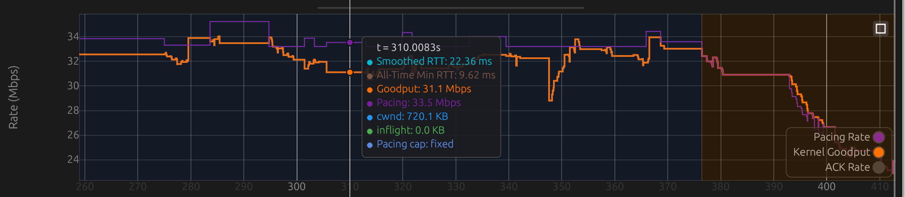

### A worked example — one second of a session

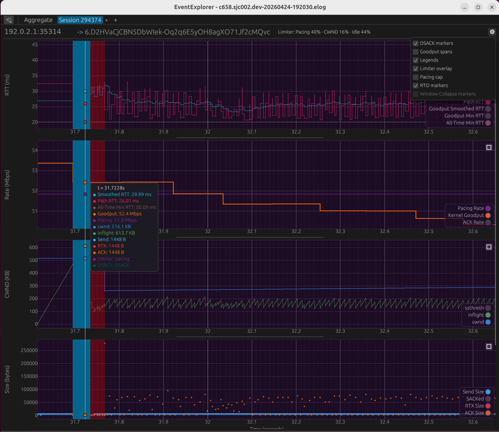

This is a tight zoom (~0.9 s of wall time) through all four
time-linked panels with several overlays at once:

- A **DSACK marker** fired at `t = 31.72 s` (teal vertical line through every panel) — the tooltip surfaces its reason text alongside the per-series values.
- The blue band around the marker is one bucket of **app-limited** shading; the wider red band immediately to the right is a contiguous **cwnd-bound** stretch (≈ 90 ms long).
- The **shared cursor** is parked just inside the cwnd-bound stretch. The tooltip lists quantities at the cursor — Smoothed RTT, Path RTT, All-Time Min RTT, Goodput, Pacing, cwnd, inflight, rwnd (if available), sndbuf, Send/RTX/ACK sizes, the active limiter class, and the DSACK reason — all read off the same vertical without leaving the panel you started in.
- The header still carries the whole-session limiter one-liner (e.g. `Pacing 40% · CWND 16% · App 8% · Idle 36%`), so the zoomed slice can be read in the context of how this session behaved overall.

### Tooltip contents

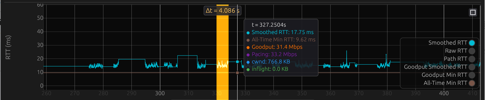

The shared vertical-cursor tooltip lists everything relevant at the
current time `t`:

- The `t` value at the cursor.
- For each visible series across all four time-linked panels, the
  current value with units (ms, Mb/s, KB, bytes).
- Any active overlay at that point: the recovery span duration
  (if inside one), the pacing cap name, or the limiter class
  (if classified).
- The reason text for any nearby discrete-event marker that is
  currently toggled on (RTO, Window Collapse, or DSACK), snapping to
  the nearest marker within ~0.5 % of the view width so cursor
  placement doesn't have to be pixel-perfect. Each marker stream is
  consulted independently, so co-located events all surface.

The **rwnd** trace appears on the Send State panel as a tan line, but
only when the session has an `EVT_CONN_PARAMS_V2` event (id 5). The
kernel logs `tiwin = ntohs(th->th_win) << snd_scale` in `EVT_IN.win`,
so the value is already in bytes; EventExplorer plots it directly.
Captures from older kernels that don't emit `CONN_PARAMS_V2` suppress
the line and `rwnd` limiter classification entirely — the historical
inconsistency between stacks means showing a potentially wrong value
is worse than showing nothing.

The **sndbuf** trace (cyan) is derived from `EVT_USER_SEND.sndbuf_used`
events, which snapshot `sbused()` (total bytes in the kernel send
socket buffer) each time the application writes. EventExplorer subtracts
in-flight bytes to produce the *backlog* — bytes queued but not yet
transmitted. This series feeds the `App`-limited and pacing heuristics
in the limiter classifier.

Connection parameters (`cc=…`, `wscale=…`, `opts=…`), session ID
(decimal), remote address, and log ID are accessible via the **ⓘ info
button** in the session header rather than inline in the title bar.

## Known kernel-side gaps

- **RWND on legacy captures.** Sessions captured by kernels
  predating `EVT_CONN_PARAMS_V2` (id 5) lack `snd_wscale`. The `rwnd`
  series and tooltip row are suppressed and the limiter classifier does
  not attempt `Rwnd`-limited classification — `%rwnd` is reported as
  `n/a`. New captures from kernels that emit `CONN_PARAMS_V2` get the
  full series, tooltip, and `Rwnd` classification automatically.
  Note: `EVT_IN.win` is the *already-scaled* peer window in bytes
  (`tiwin = ntohs(th->th_win) << snd_scale`). Kernels predating the
  `EVT_IN.win` scaling fix (present in the same series that added
  `CONN_PARAMS_V2`) logged the raw unscaled `th_win`, which is why
  EventExplorer suppresses both signals together.

## CPU flame graph

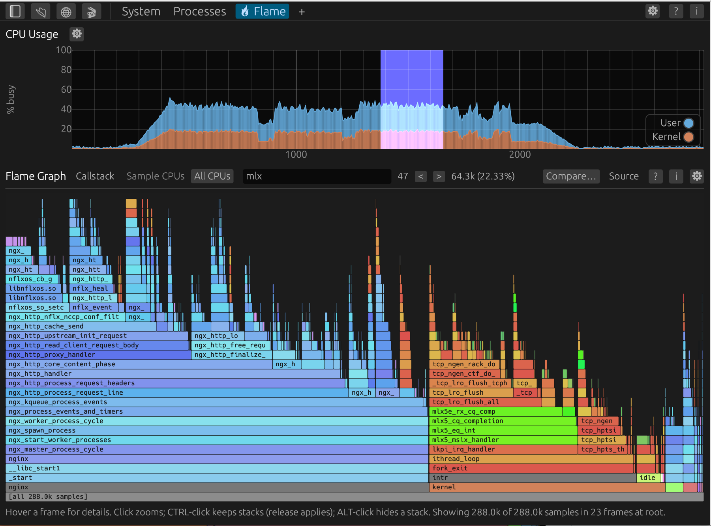

When a capture contains `cpu` provider data (per-CPU kernel-thread
stack samples — see [file-format.md](file-format.md#cpu-provider-event-id-catalog)),
the **🔥 Flame** tab appears in the tab bar. Cpu-only captures
(e.g. `oca.py get profile`) auto-focus this tab.

Flame's CPU-usage strip shares its time-window with the System tab
and the Processes tab: switching to Flame or Processes carries System's
zoomed range over, and leaving either writes the strip's time filter
back onto System. Session and Fanout channel tabs keep their own zoom.
On Flame and Processes, dragging a range on CPU Usage filters both
views to that interval (Shift+drag slides that interval; right-click
clears the filter). The CPU Usage gear's **Zoom to time window**
checkbox (off on these tabs, on for System and per-session plots)
instead shows only that window, re-binned, with the System tab's box
zoom. **Scale by CPU frequency** starts on for every CPU Usage plot.
On the flame canvas, right-click a
resolved function to open annotated source; right-click the background to go
back through zoom history.

**Sample CPUs**, on the Flame Graph line before the search box, selects an individual sampled CPU or a
group using comma-separated IDs and inclusive ranges (`0-7,16-23`). Choose
**All CPUs** to clear the selection. The same selection applies to Processes'
Top functions, stacks, and source sample counts, and to both captures in a
flame comparison. It combines with the time window and stack filters; flame
widths and percentages use the selected samples. CPU Usage also follows the
selected CPUs, with 100% relative to their capacity. Loading another capture
resets the selection.

The view is a classic Brendan Gregg flame graph: each rectangle is a
kernel function, its width is proportional to the number of samples
that pass through it, and rectangles are stacked bottom-up with the
synthetic `[all N samples]` root at the bottom (or `kernel` and
`user`, when the gear layout is **kernel / user**) and leaf-most frames
on top. Children of a frame are sorted by sample count descending so
the visually-dominant call path always reads left-to-right. Row
height is computed dynamically from the canvas height divided by the
visible subtree's depth, so the flame graph always fills the window
vertically — resizing the window or zooming into a shallower subtree
grows the bars rather than leaving empty space above the topmost
frame. A 12 px readability floor means very deep stacks clip from
the top instead of squishing labels into invisibility.

Frame labels follow a five-tier cascade (kernel resolver tried
first because most samples on a busy box are kernel-mode):

1. **Resolved kernel symbol** — when the capture carries `LINKER_FILE`
   plus `SYMBOL_RANGE` events (synthesised by `elog --embed-symbols`
   at capture time), the frame renders as `name+0xINNER` (or
   `kernel:name+0xINNER` / `if_em.ko:name+0xINNER` with **show
   module prefix** on).
2. **Resolved user symbol** — when the kernel resolver missed and
   the sample's pid has a `PROC_MAP` covering the PC (emitted live
   by the kernel's process provider) and `elog -U` (default in
   `oca.py get profile`) synthesised a matching `USER_SYMBOL_RANGE`,
   the frame renders as `name+0xINNER` (or
   `libc.so.7:recvfrom+0x12` / `a.out:main+0x40` with **show
   module prefix** on — the DSO short name is the basename of the
   `USER_FILE` pathname).
3. **DSO module-only fallback** — when the PC is in a known
   `PROC_MAP` for the sample's pid but no `USER_SYMBOL_RANGE`
   covers the resulting file offset (e.g. a stripped binary that
   `elog -U` couldn't extract any symbols from), the frame renders
   as `libfoo.so+0xRUNTIME_OFFSET` (the offset is from the runtime
   mapping's start, not the file offset — this stays meaningful
   even when there's no symbol table to fall back on). Strictly
   more useful than raw hex: you immediately see *which library*
   is hot. In `BySymbol` aggregation every
   PC under the same DSO mapping collapses to one bar so you get
   one wide `libfoo.so` strip with per-PC offset rectangles
   stacked on top.
4. **Kernel-relative** — when no symbol matches but `KERNEL_INFO`
   is present and the frame falls inside the kernel text segment,
   `kernel+0xOFFSET`. Toggle via **kernel+offset labels** (on by
   default).
5. **Raw hex** — otherwise the frame's `0xADDRESS`. User-mode PCs
   in pids whose `vm_map` `elog -U` didn't snapshot in time fall
   here (lazy-snapshot limitation in v1; see file-format docs).

In v1, only the **kernel** linker file gets `SYMBOL_RANGE` events;
kernel-side frames inside loadable `.ko` modules fall through to the
next tier (see [file-format.md → CPU symbolisation pipeline](file-format.md#cpu-symbolisation-pipeline)
for why). User-mode coverage is broader: `elog -U` opens every
backing ELF for sampled pids, so DSO frames (`libc.so.7`,
`libssl.so.3`, the executable itself) all resolve as long as the
mapping was snapshotted before the sample. EventExplorer surfaces
both kernel and user metadata counts in the header strip so you can
tell at a glance which axes are covered.

User-mode flame nodes **merge across pids by default** in the
`By symbol` view: N forks of the same binary (e.g. nginx workers)
fold into one `_start;main;…` tower, keyed on the stable
`(UserFile::user_file_id, UserSymbolRange::offset)` identity so
ASLR slides don't matter. The canonical (kept) pid for a merged
node is the first one we saw for the symbol, so tooltip labels
still resolve correctly. Flip **Split user-mode bars by pid** in
the gear menu for the pre-0.4 per-process view (one tower per
pid). Unresolved PCs always fall back to being keyed by their raw
PC (pid-scoped for user frames) — we can't prove two raw hex PCs
in two address spaces point at the same code. In the `By PC` view
user-mode bars are always
pid-scoped (raw PCs are ASLR-dependent, so there's no safe
cross-pid key).

### Header / controls

The flame tab packs everything that affects what you see into a
single controls row. Verbose metadata (kernel ident, sample / thread
counts, kernel + user symbol coverage) lives one click away in the
**(i) info popup** so the chrome above the canvas stays minimal and
the flame reclaims that vertical space.

- **(?) help button** (right side, left of (i)) — mouse and keyboard
  gestures for the canvas, stack filters, and the CPU Usage strip.
- **(i) info button** (right side) — opens a popup with flame-specific
  metadata (file identity lives on the tab-bar ⓘ popup):
    - **Kernel**: identity (`uname -i`), text range with size, CPU
      count, sample rate (Hz), and the truncated `kern.build_id`
      that `elog --embed-symbols` cross-checks against on-disk
      ELFs. Hidden when no `KERNEL_INFO` is present.
    - **Samples**: total sample count, distinct thread count,
      wall-clock span, and an `OVERFLOW dropped` row when the
      kernel reported sample loss.
    - **Kernel symbols**: linker file count, symbol count, and a
      colour-coded status (`symbolised` green / `metadata only`
      grey / absent). When in `metadata only` state, an inline hint
      tells you how to recapture with full symbols
      (`elog --embed-symbols`).
    - **User-mode symbols**: DSO count, symbol count, process-map
      count, PIDs covered, plus the same colour-coded status with
      a `elog -U` hint when symbols are missing. Hidden entirely
      when no user-mode events are present (legacy captures).
- **Search** — substring match on the visible label or `0xADDR`.
  Separate alternatives with `|` (`ella|mrelay`) to highlight every
  matching frame. A count (`n`, or `i/n` once you start walking)
  and **<** / **>** buttons sit next to the box; Next / Prev zoom
  to each match in canvas order (left-to-right, then bottom-to-top).
  Beside the arrows, the sample cost of those matches
  (`N (P%)` of the full tree) counts each sample once even when a
  hit sits under another hit. Matching frames render with a
  brighter, more saturated color so they pop out of the graph.
  Search does not filter the tree.

> **Note on idle / truncated samples.** Older revisions of this tool
> had `include idle` / `include truncated` checkboxes. They're gone:
> current kernels (post May 2026) don't emit idle samples at all — the
> statclock tail hook returns early when the per-CPU idle thread is
> running — and truncated stacks are rare enough in practice (≤ 14 out
> of 400 k samples on a live-traffic 4 kHz capture) that filtering
> them adds no visible benefit. Archival captures that still carry
> empty-stack idle samples show up as a single **IDLE** span on the
> synthetic root (and as a `IDLE <count>` line in folded-stack output);
> truncated stacks render with whatever was captured, grafted onto the
> root at the deepest frame the unwinder managed to reach.

- **(⚙) gear button** (right side) — opens a popup with the
  label / layout controls that don't need to be on screen at all
  times:
    - **by symbol / by PC** dropdown — disabled when no
      `SYMBOL_RANGE` *or* `USER_SYMBOL_RANGE` events are present
      (both modes produce the same output without symbols).
      Switching aggregation rebuilds the tree and clears the
      back-history.
        - **by symbol** (default whenever symbols are available):
          classic Brendan Gregg flame-graph view. PCs that resolve
          to the same function collapse into one bar. Per-instruction
          hotness is preserved as small **`+0xINNER` overlay
          rectangles** above the function's bar. Frames whose
          symbol can't be resolved fall back to per-PC keying.
        - **by PC**: one rectangle per unique program counter.
          Same-function hot instructions appear as adjacent sibling
          rectangles ("the function is shattered").
    - **Layout** dropdown — how the bottom of the flame is organized.
      **by process** (the default) puts `[all]` at the bottom, then
      one bar per process and a `kernel` bar. Thread names (`idle`,
      `intr`, `clock`, …) sit on that `kernel` bar.
      **kernel / user** makes `kernel` and `user` the
      bottom row; processes sit on `user`, and those same thread
      names sit on `kernel`. The Callstack view lists those two
      bases, and a zoomed frame's chain starts at `kernel` or
      `user`. **no kernel group** keeps `[all]` at the bottom and
      the per-process bars, and hangs kernel stacks directly on
      `[all]`. Searching for a process name highlights its bar. The
      Processes tab's "Open flame" button zooms to that bar (the
      merged `kernel` bar for a kernel thread, the process bar for
      a user `comm`) and switches **no kernel group** back to **by
      process** so the bar exists.
    - **blue user-space frames** — render user-space frames in blue while
      keeping kernel frames on the classic red/orange/yellow palette. This
      matches the CPU graph and makes the point where a stack enters the kernel
      visible at a glance. Search matches remain green. On by default; the
      choice is saved between sessions.
    - **kernel+offset labels** — toggle the `kernel+0xOFFSET`
      fallback. Symbolised frames are unaffected (they always win);
      off renders unresolved frames as raw hex.
    - **show module prefix** — disabled when no kernel *or* user
      symbol events are present. When enabled, prefix each
      symbolised frame with its owning linker file or DSO basename
      (e.g. `kernel:tcp_input+0x40`, `if_em.ko:em_isr+0x18`,
      `libc.so.7:recvfrom+0x12`, `a.out:main+0x40`). Useful when
      same-named symbols across modules / DSOs need disambiguation
      (e.g. `runtime.lock2` shows up in every Go binary); off by
      default to keep bar labels short.
    - **split user-mode bars by pid** — disabled when the
      aggregation dropdown is set to `By PC` (raw user PCs can't
      be safely merged across address spaces, so the setting has
      no effect there). When enabled, keep resolved user-mode bars
      scoped to the pid that ran them — one `_start;main;…` tower
      per pid. Default off: matching user-mode symbols fold across
      pids that share the same code (N forks of nginx produce one
      tower, not N), keyed on the stable
      `(UserFile::user_file_id, UserSymbolRange::offset)` identity
      so ASLR slides don't matter. Unresolved user frames stay
      per-pid either way.
    - **min bar width** slider (0 % – 2 % of canvas) — drop
      rectangles narrower than this fraction of the canvas from
      the rendered tree. Useful for captures where one corner of
      the canvas is dominated by a tower of one-pixel hex-address
      bars (e.g. when `elog -U` couldn't symbolise a process and
      every frame in its stack reads as raw hex). The bars are
      hidden, not deleted: clicking the parent zooms in and re-
      grants them width.
        - **0 %** (default) — render every bar down to ~1 px,
          historical behaviour. Best for lossless inspection.
        - **0.5 %** — drop sub-pixel slivers; the high-rise hex
          towers shrink without losing the named flames around
          them.
        - **2 %** — aggressive overview mode; only the dominant
          branches survive at the current zoom. Use as a "what
          are the big buckets?" sanity check before drilling in.

### Comparing two captures

The **Compare…** button (right side of the controls row) overlays a
second capture onto the flame as a *differential flame graph*: pick a
baseline `.elog` and the tab merges both captures' CPU stack samples
into one tree where each frame's **colour** shows how its share of
samples changed — red = grew in the current capture, blue = shrank,
neutral gray = within ~2 %. Frames new to the current capture paint
solid red; frames that vanished paint solid blue.

Bar **widths** cover both captures, normalized so each capture
contributes equally regardless of which ran longer — a frame at 50 %
of the baseline and 25 % of the current capture gets three quarters
of a full-width bar. Because widths are the union, vanished work stays
visible (solid blue) instead of disappearing.

While comparing, the chip row under the controls shows
`baseline (N) -> current (M)` sample totals, the colour legend, and:

- **Swap A/B** — invert the comparison direction (colours and deltas
  flip; widths are symmetric so nothing re-layouts).
- **×** — drop the baseline and return to the normal flame graph.

Frames are matched across captures by *symbol identity*
(`module:function`), so KASLR / ASLR slides and rebuilds of the same
kernel or binary still match; unresolved frames fall back to
`kernel+0xOFFSET` (stable for one kernel build) or raw hex (which only
matches when both captures share an address-space layout). The hover
tooltip and status strip show both raw counts as Left and Right
(the chip row names the files), each capture's percentage, and the
share delta.

Notes and limitations:

- Aggregation is fixed to by-symbol with user bars merged across pids
  (the merge is label-keyed); those gear-menu toggles are disabled
  while comparing. The layout dropdown stays live.
- One **CPU Usage** plot sits above the flame. While comparing, the
  file names next to the title switch which capture's timeline is
  shown. Drag a range to limit that capture; right-click clears it.
  **Zoom to time window** in the gear shows only that range. The two
  windows are independent.
- ALT-click hides stacks through the clicked frame, and CTRL-click
  keeps them, matched by the name on the bar so both captures agree.
  Address-scoped filters set before comparing are dropped.
- Right-click "open in source" is unavailable on diff bars.
- Loading a new primary capture clears the comparison.

### Comparing two time regions

The same differential flame can compare **two time regions of the
capture already loaded** — "what changed between the busy minute and
the quiet one?"

- **Drag** on the CPU Usage strip sets region B — it is the ordinary
  flame time filter, drawn as the blue band while comparing.
- **Alt+drag** sets region A (orange band) and opens the compare as soon
  as you release. Alt+drag again to move A; **Alt+right-click** (or the
  chip row's **×**) exits the compare, leaving B as the time filter.

The chip row reads `A 5.0–25.0s (N) -> B 30.0–60.0s (M)` with the same
colour legend, **Swap A/B**, and **×** as the capture compare, and the
same matching / normalization rules apply — frames are matched by
symbol identity, widths are the union of both regions, and colours show
each frame's change in share. Alt+drag while a *capture* compare is
open replaces it with the region compare.

### Unsymbolised PCs fall back to raw addresses

The kernel's user-stack walker can produce PCs that no symbol
table on the box covers — typically when `elog -U` raced the
exit of a short-lived process and missed its `PROC_MAP` events,
or when the unwinder followed a bad frame pointer into the
stack base. Any frame that fails every symbolisation tier (no
kernel symbol, no user symbol, no `UserModuleOnly` DSO
fallback) falls back to being keyed and labelled by its raw PC
(`kernel+0xOFFSET` when `rel_text` is on and the PC is in the
kernel text segment, otherwise `0xADDR`). Each distinct PC stays
its own node, so the canvas always represents 100 % of
post-filter samples, even when symbol coverage is patchy. Use
the **minimum bar width** filter (above) to drop the sub-pixel
raw-hex slivers a noisy unsymbolised process can produce.

### Interactions

- **Hover** a frame to see its label, sample count, and percentage
  of both the visible (zoomed) root and the full filtered tree.
  A floating tooltip appears at the cursor; the bottom status strip
  also shows a one-line summary.
- **Click** a frame to *zoom in*. The clicked frame stays at 100 %
  width. Every frame that was below it collapses into one bar
  underneath, labelled from the root up and split by `>`
  (`nginx > _start > main`). Children re-flow proportionally above
  the clicked frame. **Click that folded bar** to step down one
  level: the parent becomes the full-width frame and drops off the
  end of the `>` label.
- **Right-click** a resolved function (including a `+0xOFFSET` self-sample
  overlay) to open its annotated source tab. Right-click the canvas
  background — or press the **mouse Back side-button** (Extra1) — to *go
  back* one navigation step. Each
  back step restores the *exact* prior zoom state (browser-style
  history), not just one level: clicking a frame several rows above
  the bottom adds several path entries in one gesture, and one back
  step undoes the whole gesture as a unit. The **mouse Forward
  side-button** (Extra2) redoes a step you just undid; any fresh
  zoom clears the redo history.
- **Escape** and **middle-click** clear all zoom, the back/forward
  history, and every stack filter (CTRL keep-only and ALT hide).
  A pending CTRL selection is cancelled too.
- **CTRL + click** frames to build a *keep-only* set: each clicked
  bar gets a cyan outline and joins the pending selection shown on
  the `Filter:` row (click again to deselect). **Releasing CTRL**
  rebuilds the flame with only the samples whose stack passes
  through at least one selected bar. Works on process group bars
  too (`ella_server`, `kernel`).
- **ALT + click** a frame to *filter it out* immediately: every
  sample whose stack passes through that bar is dropped from the
  tree. Repeat to hide several stacks.
- Active filters appear as chips on the `Filter:` row above the
  canvas (`only …` / `hiding …`); click a chip's `×` to drop one,
  or **clear** to drop them all. Excludes win over includes.
- **Breadcrumb strip** appears above the canvas once you've zoomed
  (`Zoom: all › …`). Click **all** to return to the full graph;
  click any later crumb to zoom back out to that level. Breadcrumb
  clicks participate in the back-history same as canvas clicks.
- **Middle-click** anywhere on the canvas is the same reset as
  Escape (zoom, history, and stack filters).

### Reading the colors

Colors are a deterministic hash of the frame address into the
warm-half of the HSV wheel (red→orange→yellow). With **blue user-space
frames** enabled, user PCs use a light cyan-to-blue range (same
spread as the warm kernel colors) while kernel PCs stay warm. Per-PC offset
rectangles (`+0xINNER`) are green; with the blue palette on, user-space
offsets are light purple. Same address → same color across
reloads, so visual landmarks survive a re-parse.
The synthetic root at the bottom is a mid gray so the `[all …]` label
stays readable. The light theme leaves every bar, label, and outline
as in the dark theme and paints the empty canvas the same gray as
the rest of the window.
Highlighted (search-match) frames bump saturation and value so they
stand out against the surrounding bars.

### When you need offline analysis

For scripted analysis or for piping into the standard
[`flamegraph.pl`](https://github.com/brendangregg/FlameGraph) /
[Speedscope](https://www.speedscope.app/) tooling, use
`elog_cli capture.elog flame [options]` — same data, written in
folded-stack format. See [cli.md → `flame`](cli.md#flame-options).

## Performance notes

- **Min/max bucket downsampling.** Series that are not on the Time
  buckets slider are downsampled to at most 4000 points over the visible
  window before rendering, so the UI stays responsive on traces with
  millions of events.
- **Memory.** After parsing, event variants that aren't needed for plots
  (timers, MSS updates, socket options, …) are dropped from the in-memory
  session map, which trims roughly 60 % off RSS.
- **Startup on Linux/X11.** On startup, EventExplorer clears
  `WAYLAND_DISPLAY` when `DISPLAY` is set to force X11 — this avoids a few
  window-positioning bugs with eframe/winit under mixed sessions.

## Persistence

Stored under `~/.config/event_explorer/` (desktop only — the browser
build keeps everything in memory and resets on reload):

- `recent_files.txt` — most-recently-opened captures (max 10), one per
  line. A rolled set opened as one capture is one line, its paths
  tab-separated, so the entry reopens the whole set.
- `plot_bins` — Time buckets count from the tab-bar gear. The browser
  build stores the same value in `localStorage`.
- `window_state.txt` — last window size, position, and maximized state.
  Geometry is ignored on restore if the primary monitor's resolution has
  changed since the last save.
- `source_lookups.txt` — local executable/debug-file locations and accepted
  DWARF-to-local source rewrites, kept separately for each executable and
  offered as defaults that must be explicitly accepted for a new capture.

## Browser build

EventExplorer also compiles to WebAssembly and runs entirely in a
browser tab — same UI, same parser, same plots. Useful for sharing a
quick look at a capture without asking colleagues to install anything.
See [architecture.md → Web target](architecture.md#web-target-wasm32)
for the build commands and hosting recipes.

To run locally:

```bash
trunk serve     # opens http://127.0.0.1:8080/
```

User-visible differences from the desktop GUI:

- **Open via the browser file picker, a URL, or a hosted logs list.**
  Click *Open File…* to upload one or more `.elog` / `.elog.gz` files
  (read into memory in the tab; they never leave the browser; several
  files open as one [rolled set](#rolled-capture-sets)). Or paste one or
  more space-separated `http(s)` capture URLs into *Or open from a URL*
  and press Enter / *Open* — same fetch as `?file=` (`history.pushState` so Back
  returns to the splash; a refresh still reloads the capture). The
  host must allow this origin (CORS). When
  the page is served next to a `../logs/` autoindex (a dev host's
  `~/public_html` layout: `…/eventexplorer/` beside `…/logs/`), the splash also lists
  those captures — including one subdirectory — for one-click open.
  Drag-and-drop is not wired up (yet).
- **No recent-files list.** The list resets every time you reload the
  page — wasm has no filesystem to persist to. (A future improvement
  could wire this up to `localStorage`.)
- **No SSH remote-fetch.** The "Open Remote…" button is hidden in the
  browser build; there's no way to spawn `ssh` from a sandboxed tab.
- **A 🔗 Share button** appears in the tab bar — see
  [Sharing a view](#sharing-a-view) below.
- **The page can hitch during the event scan.** Browsers run wasm on the
  main thread. Download and gzip now yield so the loading bar and
  status ("Fetching 12 MiB / 91 MiB", "Decompressing…") update; the
  parse itself still occupies one JS turn after the status switches to
  "Parsing events…". Captures up to a few hundred MB are comfortable;
  multi-GB captures will likely run out of heap (the wasm32 sandbox
  caps at ~4 GB).
- **Slower parse.** No `rayon` parallelism on web — the per-session
  sort and summary loops run sequentially.
- **No window-state / monitor-aware geometry.** The browser owns the
  tab geometry; the desktop's `xrandr`-aware resize-on-monitor-change
  logic is gated out.
- **Dark** is on both the splash and the tab bar (same as desktop).
  The web copy is stored in `localStorage` instead of
  `~/.config/event_explorer/`.
- **Favicon.** The tab uses a pixel-aligned navy **E** with cyan/gold
  bars, in the same palette as the desktop window icon.

Everything else — tabs, panels, overlays, tooltip, info popup, limiter
shading, discrete-event markers, the System tab — works
identically.

### Sharing a view

The 🔗 button in the tab bar opens a *Share* dialog that produces a
permalink to the current view. Anyone opening the link lands on the
same capture, the same active session tab, the same visible time
window, and the same set of toggles you've enabled or disabled.

How the capture itself reaches the link depends on where it came
from:

- **Loaded from a URL** (web, `?file=…`): the link embeds that URL
  as `file=`. The popup is a real browser text field (not canvas
  text) with a *Copy to clipboard* button, so Ctrl+C and the
  right-click Copy menu work, including on plain HTTP.
- **Loaded from your computer** (file picker on web, or any desktop
  load): when the build has a share server configured (`uploads_url`
  in the [site config](site-config.md)), the dialog offers to
  **upload the capture** first. Enter a cache name (pre-filled from
  the capture's own hostname when it has one) and an optional note,
  and click **Upload to Share** (web) or **Upload & Copy Link**
  (desktop). The bytes go straight from your machine to object
  storage on a presigned URL — the share server never proxies them —
  and the upload's long-lived download URL (a 307 to a
  freshly-signed GET on every fetch) becomes the link's `file=`, so
  the link lives as long as the upload. Any site-specific note
  (`upload_note`: retention, network requirements) is shown in the
  dialog. One upload is capped at
  2 GiB. A rolled set uploads each file in turn and the link loads
  the whole set. The `file=` URL carries the original file name in a
  `#fragment` — display-only, never sent to the server — so the
  loaded capture still titles itself `foo.elog.gz` rather than
  `download`.
- **Desktop specifics**: the dialog is an egui window, and when the
  upload completes the permalink is already on your clipboard. The
  desktop sends API requests through the site's `http_command` (plain
  `curl` by default), which is where a site adds authentication.
  Without a share server the 🔗 button is hidden on desktop.
  Captures loaded over SSH can't be
  uploaded from the dialog — run `elog_cli upload` on that host
  instead (see [cli.md](cli.md#upload)).
- **Web specifics**: the browser calls the share server with the
  hosting page's session/cookies. Without a share server the dialog
  shows only the view link. When the upload finishes the overlay swaps to
  the link and the page URL is updated in place, so a refresh
  reloads the uploaded capture. Copy is a click away — browsers
  don't let pages pre-empt the clipboard.

The URL is built from these query parameters (all optional):

| Param           | Meaning                                              | Default                   |
|-----------------|------------------------------------------------------|---------------------------|
| `file`          | URL of the capture to fetch (resolved against the page origin). Repeat it to load a rolled set as one capture. | (set when loaded via `?file=…`) |
| `tab`           | Static tab to focus: `system`, `sessions`, `flame`, `processes`. | auto-focused tab |
| `session`       | Decimal TCP session id to open and focus.            | none — System tab         |
| `channel`       | Fanout channel tab: `<provider_id>,<session_id>`.    | none                      |
| `plot`          | Catalog row to scroll into view (e.g. `session_rtt`, `fanout_relay_subs`, `ella_ch_frame_rate`). | none |
| `t`             | `<start>,<end>` time window in seconds since capture start (System zoom, session zoom, Fanout channel zoom, or Flame highlight). | full range |
| `agg_filter`    | System-tab "Hide short sessions" filter (`0`/`1`).   | `1`                       |
| `utc`           | UTC time-axis labels toggle (`0`/`1`).               | `0`                       |
| `recovery`      | Recovery-spans overlay (`0`/`1`).                    | `1`                       |
| `goodput_spans` | Goodput-spans overlay (`0`/`1`).                     | `0`                       |
| `pacing_cap`    | Pacing-cap overlay (`0`/`1`).                        | `0`                       |
| `limiter`       | Limiter overlay (`0`/`1`).                           | `0`                       |
| `rto`           | RTO markers (`0`/`1`).                               | `0`                       |
| `wcoll`         | Window-collapse markers (`0`/`1`).                   | `0`                       |
| `dsack`         | DSACK markers (`0`/`1`).                             | `0`                       |
| `legends`       | Per-panel legends (`0`/`1`).                         | `1`                       |
| `max`           | Maximize one panel (`0`=RTT, `1`=Rate, `2`=Send State, `3`=Sizes, `4`=Size CDF). | none |
| `ymax`          | Y-axis upper bounds, e.g. `0:120,2:200`.             | none — auto              |

The URL only includes parameters that differ from the defaults, so
sharing a view with a clean state stays compact (just `file`,
`session`, `t`). `tab` / `channel` / `plot` let a link land on any tab
and scroll to one catalog row.

One edge case to know about:

- If you're on the System or Session List tab when you click 🔗,
  no `session=`/`t=`/per-session toggles are included — open a
  specific session tab first to lock in the time window.
